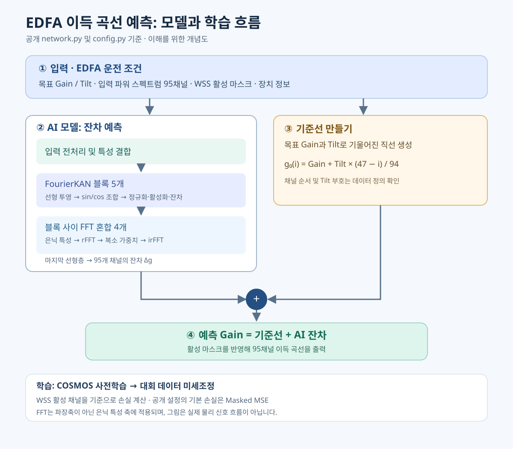

# OFC 2026 ML Challenge: SJTU 코드·논문 분석 및 Transformer 비교

분석일: 2026-11-15. 대상: [사용자가 지정한 코드](https://github.com/kayneZhu/ofc_ml), 첨부 Report_SJTU.pdf, [PI_EDFA_Transformer](../PI_EDFA_Transformer/). 논문은 코드 주소로 yukangZhuu/ofc_ml을 기재하므로 두 저장소·체크포인트가 동일한 최종 제출본인지는 별도 검증이 필요하다. 논문은 경쟁력 있는 점수라고 기술하며 순위는 첨부 논문만으로 확인하지 못했다. 코드를 실행하거나 모델을 재학습하지 않았다.


## 모델 흐름 한눈에 보기



[그림 크게 열기](./winner_model_architecture.svg)

**그림 읽는 순서:** ① 운전 조건과 채널 데이터를 넣는다 → ② AI가 기준선에서 벗어나는 모양을 예측한다 → ③ 목표 Gain·Tilt로 기준선을 만든다 → ④ 두 결과를 더해 채널별 Gain을 얻는다. 학습 시 정답과의 오차는 활성 채널 기준으로 계산한다.

FourierKAN의 사인·코사인 계수는 학습되지만 주파수 인덱스는 고정이다. FFT 혼합은 5개 블록의 사이에 4회 적용된다. 위 그림은 현재 공개 설정 기준이며 논문의 최종 제출 설정을 독립 확인한 것은 아니다.

## 비전공자 설명

EDFA는 여러 색의 빛을 동시에 키우는 광 증폭기다. 모든 색이 똑같이 증폭되지 않아 색별 이득 곡선(gain profile)을 예측해야 한다. 이 모델은 각 색의 입력 세기, 켜진 채널, 목표 이득·기울기와 장비 설정을 받아 95개 위치의 증폭량을 추정한다. 먼저 목표 이득과 기울기로 대략적인 직선을 그린 다음 실제 곡선과의 차이를 AI가 예측한다. 여러 파장에 걸친 관계를 한꺼번에 학습해 채널 간 영향을 반영하려는 방식이다. 예측이 정확할수록 운용자가 증폭 상태를 사전에 파악하는 데 도움이 되지만, 학습에서 보지 못한 장비나 노화 조건에도 정확하다는 보장은 없다.

**비유:** 목표 이득은 기준 높이, 기울기는 경사진 바닥, 모델의 잔차는 바닥에 남은 요철이다. 단, Fourier 변환은 광파 자체를 변환하는 것이 아니라 모델 내부 숫자를 처리한다.

## 전공자 설명

목표 gain과 tilt로 95채널 기준선을 만들고, 활성 채널의 측정 gain에서 이를 뺀 잔차를 회귀한다. 채널 i=0…94, 중심 c=47에 대해

`baseline[i] = target_gain + target_gain_tilt × (47 - i) / 94`

이고 예측은 baseline + residual이다. 부호는 입력 채널 순서와 tilt 정의에 의존하므로 데이터 기준으로 검증해야 한다. WSS 마스크는 활성 채널만 손실에 기여하도록 한다. 코드의 비활성 출력은 0으로 마스킹되며, 제출 규칙의 비활성 값은 별도 확인해야 한다.

논문은 외부 COSMOS JSON을 대회 형식으로 변환하고 유효하지 않은 총 출력파워(예: -50 dBm)를 제거한 다음 COSMOS 사전학습, 대회 데이터 미세조정을 설명한다. 데이터 변환, 품질 기준 및 중복·기기·시간 식별은 독립 재현 시 직접 확인해야 한다.

### 알고리즘과 실제 구현

1. [features.py](https://github.com/kayneZhu/ofc_ml/blob/main/src/ofc_ml/features.py): 수치/범주 및 입력 스펙트럼 전처리. 마스크 none/concat/multiply 선택.
2. [network.py](https://github.com/kayneZhu/ofc_ml/blob/main/src/ofc_ml/network.py): FourierKANLayer는 선형투영 u=Wx+b 후 u + Σ[aₖsin(ku)+bₖcos(ku)]를 계산한다. 주파수 k는 고정, 진폭은 학습된다. LayerNorm·GELU·dropout 및 잔차 연결을 사용한다.
3. SpectralMixingLayer는 은닉 특징 벡터에 rFFT를 적용하고 일부 저주파 계수에 학습 가능한 복소 가중치를 곱한 다음 irFFT를 수행한다. 나머지 계수는 유지하고 블록 출력에 잔차로 더한다. **은닉 차원에 대한 FFT이므로 이를 파장축의 직접적인 물리적 주파수 분석이라고 단정할 수 없다.** 일반적인 완전한 FNO 구현과 동일하다고 단정하지 않는다.
4. [model.py](https://github.com/kayneZhu/ofc_ml/blob/main/src/ofc_ml/model.py): 기본 MaskedMSELoss 및 선택적 점수 근사 손실, 조기 종료와 스케줄러를 구현한다. 현재 [config.py](https://github.com/kayneZhu/ofc_ml/blob/main/src/ofc_ml/config.py)의 USE_KAGGLE_SCORE_LOSS는 none이다. README의 설명과 현재 config의 값이 다를 수 있다.
5. [main.py](https://github.com/kayneZhu/ofc_ml/blob/main/main.py)는 COSMOS+Kaggle 전체 특성으로 전처리를 fit한 뒤 학습 내부에서 분할한다. 따라서 내부 검증의 전처리 통계에 검증 샘플이 포함될 수 있다. 목표값 누출과는 구별하되 재현 비교에서는 분할 후 train만으로 fit해야 한다.

### 의사코드

```text
COSMOS JSON → 대회 형식 변환 → 품질 검사
대회 학습 특성·정답 읽기, 채널 순서와 활성 마스크 확인
학습/검증/시험 그룹 먼저 분리; 전처리는 학습에만 fit
각 샘플: baseline = target_gain + target_tilt * (47 - i)/94
잔차 정답 = (측정 gain - baseline) × mask
COSMOS로 FourierKAN + 은닉축 FFT mixing 사전학습
대회 학습 데이터로 낮은 학습률 미세조정
활성 채널 손실로 최적화; 검증 데이터로 조기 종료
gain 예측 = baseline + 예측 잔차
고정 시험 데이터에서 공식 점수 및 채널/조건별 오차 평가
```

이 의사코드의 선분할은 누출 방지를 위한 **권장 재현 절차**이며 공개 main.py의 현재 실행 순서와 다르다.

## 비교: 현재 사용자 Transformer

| 항목 | SJTU 공개 코드·논문 | 사용자 코드 | 개선 방향 |
|---|---|---|---|
| 기준선 | gain/tilt + 잔차 | gain/tilt + 잔차 | 이미 공통점. 부호·채널 순서 단위시험 |
| 전역 의존성 | FourierKAN + 은닉축 FFT | 95 채널 attention, 2층·4 heads | 동일 데이터에서 구조만 바꾼 ablation |
| 특성 | 정규화 입력·mask·범주 | 파워 mW 비중, 활성율, 위치 등 물리 특성 | 기존 장점 유지하며 특성 조합 실험 |
| 학습 데이터 | 논문상 COSMOS 사전학습 + 대회 fine-tune | 공식 학습 또는 Full-COSMOS 별도 평가 | 동일 분할·중복 제거 후 2단계 실험 |
| 손실 | 현재 설정 masked MSE; 대안 점수 근사 구현 | 공식점수 지향 대리손실 및 활성 mask | 동일 공식점수 선택 및 loss ablation |
| 검증 | 내부 random split; 전처리 fit 순서 주의 | 공식 코드 group split; Full-COSMOS 스크립트 random split | 기기·측정 세션 기준 group holdout |
| 일반화 | aging/SHB/unseen 평가 목표 | TestGround 세 그룹 및 오차 기록 | 그룹별 tail/bias 및 반복 seed 평가 |

현재 사용자 저장 결과: 공개 TestGround 종합 score 0.333409, MAE 0.262316 dB; Aging 0.163582, SHB 0.193067, Unseen 0.364862. 논문 수치: **검증 MAE 0.054 dB**, Kaggle 비공개 test score **0.09258**. 서로 데이터·분할·지표가 다르므로 직접 우열이나 개선 배수로 비교할 수 없다. 사용자 validation_metrics.json의 score 0.185417도 별도 93샘플 결과다. 대회 공식 score와 MAE는 서로 다른 지표다.

## 장단점 및 권장 실험

- 장점: 기준선 잔차 및 활성 마스크로 문제를 단순화하고, 외부 데이터 사전학습을 활용한다.
- 한계: 파장축이 아닌 은닉축 FFT의 물리적 해석은 제한적이며, 무작위 분할의 유사 샘플 누출 및 전처리 fit 시점이 검증에 영향을 줄 수 있다. 데이터·가중치·최종 제출본 식별과 라이선스는 별도 확인이 필요하다.
- 우선순위: (1) 동일 데이터/그룹 분할과 공식 scorer 고정, (2) 중복·전처리 누출 검사, (3) 기존 모델에 COSMOS 사전학습 추가, (4) FourierKAN/mixing과 loss를 한 번에 하나씩 변경, (5) 3개 이상 seed 및 그룹별 오차 보고. 공식 TestGround를 반복 튜닝에 사용하면 독립 테스트가 아니므로 추가 holdout을 확보한다.
- 개선은 가설이며 우승 점수 도달을 보장하지 않는다. 입력 시점에 총 출력파워가 실제 이용 가능한지 확인하고, 불가능하면 해당 특성을 제거한 실험도 실시한다.
