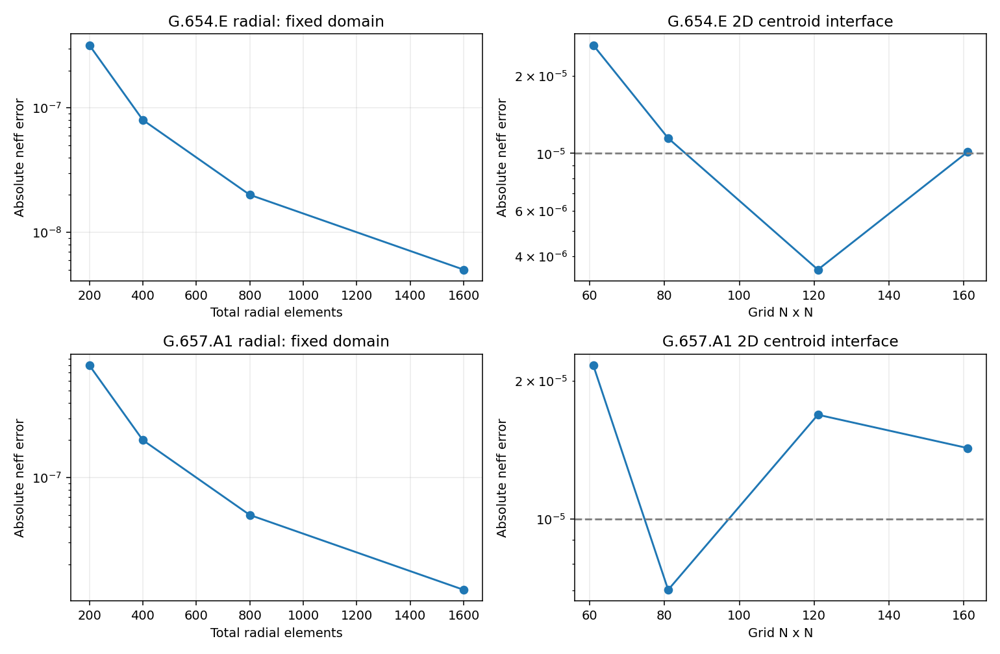

# 광섬유 시뮬레이션 입력·출력 사용 설명서

[](https://colab.research.google.com/github/kimheeseo/LSCNS/blob/main/COMSOL/fiber_simulation_guide/Fiber_Input_Output_Examples.ipynb)

**G.654.E·G.657.A1 · 실행 결과가 포함된 통합 Colab 보고서 · 2026-10-19**

가정한 원형 step-index 광섬유에 대해 입력값을 바꾸고 모드·유효면적·분산을 계산합니다. 실제 제품의 내부 구조나 COMSOL 전체 기능을 재현한 도구는 아닙니다.

[실행형 보고서 파일](Fiber_Input_Output_Examples.ipynb) · [기본 실행 결과 ZIP](Fiber_Input_Output_Results.zip) · [상세 원시 JSON](results/summary.json)

## 1. 사용 순서

1. 위 Colab 버튼을 누릅니다. 저장된 결과와 그림을 먼저 볼 수도 있습니다.
2. **4. 입력값** 셀에서 두 광섬유의 파장·반경·MFD/Δn·Mesh 설정을 변경합니다.
3. `런타임 → 모두 실행`으로 현재 입력의 결과를 계산합니다.
4. **6번 현재 입력/출력 표**를 확인합니다. **7번 예시 표는 고정 예시**이며 사용자 설정과 별도로 계산합니다.
5. 8번 Mesh 검사와 9번 계산영역 검사를 확인한 뒤 마지막 셀에서 ZIP을 받습니다.

## 2. 두 가지 입력 모드

| 모드 | 입력값 | 계산되는 값 | 의미 |
|---|---|---|---|
| 직접 계산 | 파장, 가정 코어 반경 a, Δn | MFD, Aeff, n_eff, D, S 등 | 가정한 단면의 예측 |
| MFD 보정 | 기준 파장, 목표 MFD, 가정 코어 반경 a | 목표 MFD에 맞는 Δn과 나머지 특성 | MFD는 보정값이며 독립 검증값 아님 |

`fit_delta_n_from_mfd=True`이면 두 단면의 Δn을 각각 보정합니다. `False`이면 `manual_delta_n`을 사용하고 목표 MFD는 보정에 사용하지 않습니다.

## 3. 입력 항목·단위·기본값

| 항목 | G.654.E 기본값 | G.657.A1 기본값 | 의미 |
|---|---:|---:|---|
| 분석 파장 | 1550 nm | 1310 nm | 현재 모드/특성을 계산하는 파장 |
| MFD 기준 파장 | 1550 nm | 1310 nm | 공개 MFD에 대응하는 고정 보정 파장 |
| 목표 Petermann-II MFD | 12.5 µm | 9.2 µm | 공개값 참고 보정 목표 |
| 코어 반경 a | 5.5 µm | 4.1 µm | **가정값**, 코어 지름 아님 |
| 직접 입력 Δn | 0.0034785793846155 | 0.0046215295453259 | n_core−n_clad의 절대 차이 |
| n2 | 2.2e-20 m²/W | 2.6e-20 m²/W | gamma 계산용 가정값 |

클래딩 굴절률은 silica Sellmeier로 파장에 따라 계산합니다. `n_core=n_clad+Δn`이며, 보정한 Δn은 파장에 대해 일정하다고 가정합니다. 실제 Ge 도핑·trench 분산은 입력하지 않았습니다.

### Mesh와 계산영역 입력

| 입력 | 기본값 | 뜻 |
|---|---|---|
| `radial_core_mesh_text` | `40,80,160,320` | 코어의 radial 요소 수, 증가 순서로 입력 |
| `cladding_to_core_element_ratio` | 4 | 클래딩 요소 수=코어 요소 수×4 |
| `radial_outer_radius_um` | 40 µm | radial 메시 검사에서는 이 영역을 고정 |
| `mesh_2d_text` | `61,81,121,161` | N×N 노드, 홀수 N≥15 |
| `box_2d_halfwidth_um` | 24 µm | 2D 전체 계산 폭은 48 µm |
| `run_2d_fem` | True | 실제 2D FEM 실행 여부 |

Radial 총 요소 수는 기본 설정에서 200/400/800/1600입니다. 2D 삼각형 수는 `2(N−1)²`이며 161×161에서 51,200개입니다. 두 방식의 요소 수를 같은 의미로 비교하지 마십시오. 큰 N은 계산 시간·메모리가 늘어나므로 단계적으로 높이십시오.

## 4. 출력 항목

| 결과 | 단위 | 해석 |
|---|---|---|
| n_core, n_clad, V, n_eff | 무차원 | 가정한 단면의 모드 특성 |
| 2D 모드 세기 | 상대 세기 | 실제 2D FEM 그림, 이론 예측과 구분 |
| MFD_PII / MFD_2nd | µm | Petermann-II / 중심 2차 모멘트 정의 |
| Aeff | µm² | 장 적분으로 산출한 비선형 유효면적 |
| D / S | ps/(nm·km) / ps/(nm²·km) | 이론 n_eff의 파장 미분 |
| λ0 / S0 | nm / ps/(nm²·km) | 1280–1360 nm 지원 구간에서 영점을 찾은 경우만 표시 |
| gamma | 1/(W·km) | 입력 n2와 해당 분석 파장의 Aeff로 계산 |
| FEM 오차 / 잔차 | 절대 / % | 이론해와의 차이 및 고유문제 잔차 |
| Mesh·영역 비교 CSV | — | 설정별 값과 오차 |

`lambda0_status=NOT_RESOLVED_IN_SUPPORTED_INTERVAL`은 지원 구간에서 계산하지 못했다는 뜻입니다. 영분산 파장이 없다는 의미가 아닙니다. 현재 G.654.E 기본 단면의 짧은 파장 영역은 LP01 oracle의 V<2.405 지원 범위를 벗어나므로 λ0를 억지로 출력하지 않습니다.

## 5. 실제 재계산 예시

아래 값은 이 문서를 위해 실제 실행한 Colab 코드의 출력입니다. MFD는 Petermann-II, Aeff·D·gamma는 **분석 파장**에서의 값입니다.

| 예시 | 분석 파장 nm | 반경 µm | Δn | 해당 파장 MFD µm | Aeff µm² | D ps/(nm·km) |
|---|---:|---:|---:|---:|---:|---:|
|A: G654E baseline|1550|5.5|0.00347858|12.5000|121.9225|19.8257|
|B: G657A1 baseline|1310|4.1|0.00462153|9.2000|66.2679|0.5604|
|C: G654E analysis 1610 nm|1610|5.5|0.00347858|12.8639|128.2056|23.2773|
|D: G657A1 analysis 1550 nm|1550|4.1|0.00462153|10.5430|84.4595|16.6418|
|E: G657A1 manual delta_n|1550|4.1|0.00460000|10.5655|84.7887|16.6222|
|F: G657A1 assumed radius 3.8 um|1550|3.8|0.00441095|10.7716|86.9621|14.9553|

- A/B: 기본값으로 목표 MFD에 Δn을 보정합니다.
- C/D: 분석 파장만 변경합니다. MFD 보정 기준은 각각 1550/1310 nm로 유지합니다.
- E: `fit_mfd=False`, Δn=0.0046 직접 입력. MFD는 모델 예측입니다.
- F: 가정 반경을 3.8 µm로 바꿔 같은 MFD에 다시 보정합니다. Aeff와 D는 달라집니다.

### Pythonから直接呼ぶ例

```python
from simulation import PRESETS, summarize

# G.657.A1: MFD는 1310 nm에서 보정, 분석은 1550 nm
cfg = {**PRESETS["G.657.A1"], "analysis_wavelength_nm": 1550.0}
fiber, result = summarize(cfg, fit_mfd=True, outer_um=40.0)
print(result["MFD_PII_um"], result["Aeff_um2"], result["D_ps_nm_km"])

# MFD 목표를 사용하지 않고 Delta n 직접 입력
cfg["manual_delta_n"] = 0.0046
fiber, result = summarize(cfg, fit_mfd=False, outer_um=40.0)
print(result)
```

위 예시는 이 폴더에서 실행합니다.

## 6. Meshを変えると何が変わるか

계산영역을 고정하고 Mesh를 세분화하는 검사와, Mesh 간격을 유지하고 영역을 키우는 검사를 분리했습니다.

| 광섬유 | 2D 격자 N | n_eff 절대오차 | Aeff 상대오차 절댓값 (%) |
|---|---:|---:|---:|
|G.654.E|61|2.62901e-05|2.14538|
|G.654.E|81|1.14544e-05|0.315152|
|G.654.E|121|3.54192e-06|0.436234|
|G.654.E|161|1.01356e-05|0.170127|
|G.657.A1|61|2.16053e-05|1.63571|
|G.657.A1|81|7.01539e-06|1.14539|
|G.657.A1|121|1.6867e-05|0.113268|
|G.657.A1|161|1.42728e-05|0.0469783|



원형 경계 정합 FEM은 반경 경계에 맞춰 계산합니다. 기존 2D 방식은 삼각형 중심점으로 코어/클래딩을 분류하므로, Mesh를 바꿀 때 경계 근사도 달라져 오차가 비단조적일 수 있습니다. 작은 잔차나 단일 Mesh의 유리한 결과만으로 전체 정확도를 주장하지 않습니다.

이 통합 시연의 선택된 수치 확인은 6/8 통과입니다. 두 기본 단면의 2D n_eff 기준 미달을 보존합니다. 제품별 기존 보고서의 12개 검사와는 검사 구성이 다르므로 수를 합치지 않습니다.

## 7. 핵심 수식

- `Aeff = (∫|E|² dA)² / ∫|E|⁴ dA`
- `MFD_2nd = 2 sqrt(2 <r²>)` (중심 기준)
- `D = -(λ/c) d²n_eff/dλ²` (구현은 µm→ps/(nm·km) 변환 포함)
- `gamma [1/(W·km)] = 2π n2 / (λ[m] Aeff[m²]) ×1000`
- `n_eff 절대오차 = |n_eff,FEM − n_eff,Bessel|`
- CSV의 `Aeff_error_pct = 100×(Aeff,FEM/Aeff,Bessel−1)`는 부호 포함, 위 표는 절댓값입니다.

## 8. 계산 불가·미검증 항목

실제 제품 감쇠, G.657.A1 굽힘 손실, 측정 케이블 컷오프, PMD·복굴절, 임의 굴절률 분포·trench, full-vector Maxwell 또는 COMSOL 직접 동등성, BER·최대 전송거리·GN 전송 모델은 포함하지 않습니다.

MFD 목표와의 일치는 보정 결과입니다. 실제 제품 오차를 구하려면 측정 굴절률 구조 또는 보정에 쓰지 않은 독립 실측값이 필요합니다. MFD_PII와 MFD_2nd의 정의도 구분해야 합니다.

## 9. 지원 범위와 실행 파일

현재 해석해 지원은 `0<V<2.405`입니다. 보정 시 V=0.85–2.4046 범위에서 해를 탐색합니다. 파장·반경·MFD 조합이 이 범위를 벗어나면 오류를 표시하며 외삽하지 않습니다.

```bash
python -m pip install -r requirements-tested.txt
python run_report.py --in-process
```

일반 Jupyter 커널 환경에서는 `python run_report.py`로 실행할 수 있습니다. 이번 저장된 결과는 실제 IPython 코드 셀 실행이며 Colab 웹 UI의 수동 클릭 검증은 수행하지 않았습니다.

`build_notebook.py`는 노트북을 새로 만들며 저장된 출력을 초기화합니다. 수정 후에는 `run_report.py`를 다시 실행하십시오.

| 파일 | 내용 |
|---|---|
| `Fiber_Input_Output_Examples.ipynb` | 입력 양식·예시·실제 출력·그래프 |
| `results/current_inputs.csv` / `current_outputs.csv` | 현재 입력과 출력 |
| `results/example_inputs_outputs.csv` | 고정 예시 6개의 입력/출력 |
| `results/radial_mesh.csv` / `cartesian_mesh.csv` | Mesh별 결과 |
| `results/radial_domain.csv` | 외부 영역 영향 |
| `results/summary.json` | 환경·설정·판정·원시 수치 |

## 10. 제품별 기존 보고서·자료

- [G.654.E 기존 보고서](../g654e_validation/README.md)
- [G.657.A1 기존 보고서](../g657a1_validation/README.md)
- [기존 M7 연구용 수치 검증](../research/README.md)
- 제품 MFD 입력의 배경: [LS 2025 브로셔 p.3](https://fliphtml5.com/plzsm/rgkq/20250925_%ED%86%B5%EC%8B%A0_%EB%B8%8C%EB%A1%9C%EC%85%94/) — 실제 프로파일을 제공하는 자료로 사용한 것은 아닙니다.
