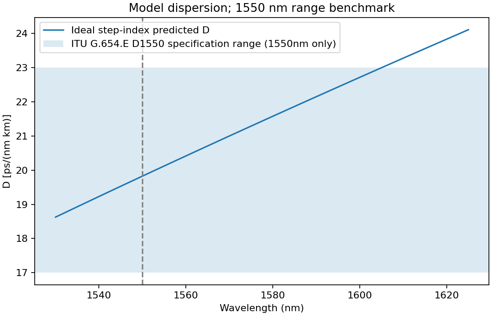
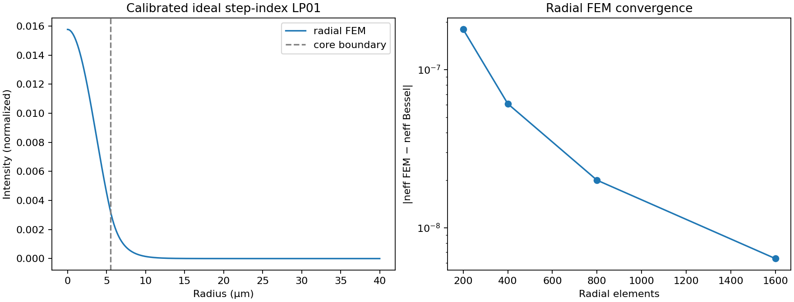
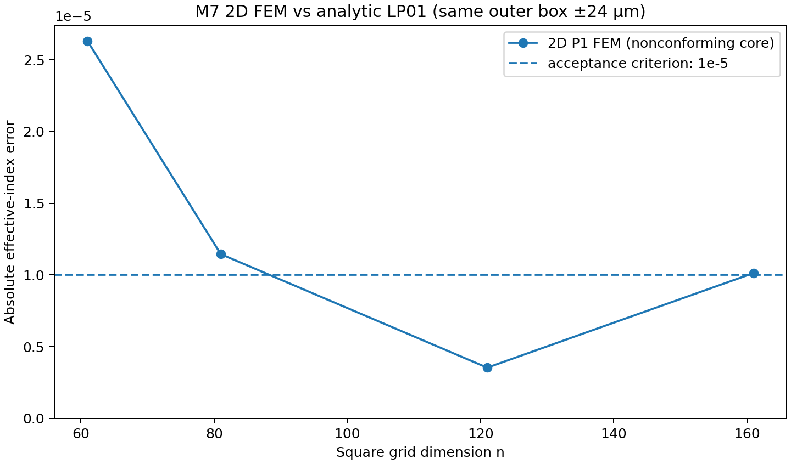

# G.654.E (LS PremierLink LE125) — FEM verification report

**Date:** 2026-10-19  
**Repository:** [LSCNS/COMSOL](https://github.com/kimheeseo/LSCNS/tree/main/COMSOL)  
**Status:** **11/12 tested numerical criteria passed**. **NOT a manufacturer-product or ITU compliance certification.**

## 1. Sources and scope

1. LS Cable & System, *2025 Telecommunication Brochure* — publicly shown **PremierLink LE125, G.654.E, nominal MFD 12.5 µm at 1550 nm; attenuation ≤0.17 dB/km**: https://fliphtml5.com/plzsm/rgkq/20250925_%ED%86%B5%EC%8B%A0_%EB%B8%8C%EB%A1%9C%EC%85%94/ (p. 3).
2. ITU-T G.654 (08/2024) Table 5 — G.654.E **D1550 17–23 ps/(nm·km)**, **S1550 0.050–0.070 ps/(nm²·km)**, **cabled attenuation maximum 0.23 dB/km at 1550 nm**: https://www.itu.int/epublications/publication/itu-t-g-654-2024-08-characteristics-of-a-cut-off-shifted-single-mode-optical-fibre-and-cable .
3. GitHub source read 2026-10-19: `COMSOL/waveoptics_m7/src/fiber_modes.py`, `radial_fem.py`. Reconstructed numerical methods locally for runtime verification. Not COMSOL commercial solver output.

**Critical distinction:** Real LE125 index profile (core radius, dopant profiles, depressed cladding) has not been publicly established in this work. We **assume a radius a=5.5 µm and fit Δn to the public MFD** using an ideal, circular, constant-Δn step-index model. Thus the MFD comparison is *calibration*, never independent product validation. The predicted Aeff, neff, dispersion depend on this simplified profile. Measured loss cannot be inferred from a real, lossless index eigenproblem.

## 2. Model and definitions

- λ=1.550 µm; silica Malitson Sellmeier for cladding, with `ncore=nclad+Δn` and constant Δn across wavelength.
- **Scalar LP01 weak-guidance** equation solved with (i) independent Bessel-root oracle; (ii) circular interface-aligned 1D radial P1 FEM; and (iii) M7 2D triangulated P1 FEM with centroid-based material classification. No vector Maxwell or PML.
- `Aeff=(∫|E|²dA)²/(∫|E|⁴dA)`.
- **Second-moment MFD** = `2 sqrt(2⟨r²⟩)`; differs from **Petermann-II MFD** used as a separate modal definition. The 2D M7 code currently computes the former only.
- `D = -(λ/c)d²neff/dλ²` via five-point difference on **Bessel oracle** (not a noisy 2D FEM sweep); dispersion slope from symmetric differences.
- Comparisons to product MFD should ensure identical measurement convention; model Petermann-II is a proxy, not a claim about the manufacturer metrology.

## 3. Calibrated parameters and predictions

| Property | Predicted / assumed | Method |
|---|---:|---|
| λ | 1550 nm | Specified |
| Core radius `a` | 5.500 µm | **Assumed**, unknown actual value |
| Index step Δn | 0.003478579 | **Fitted** from MFD 12.5 µm |
| Cladding `n` | 1.444023622 | Sellmeier silica |
| Core `n` | 1.447502201 | Simplified step index |
| V | 2.236018 | Mode parameter |
| LP01 neff | 1.445718991 | Bessel analytic |
| Petermann-II MFD | 12.500 µm | **Calibration**, not verification |
| Second-moment MFD | 12.820 µm | Bessel analytic |
| Aeff | 121.923 µm² | **Prediction**, no independent LE125 Aeff source |
| D at 1550 nm | 19.826 ps/(nm·km) | In G.654.E allowable band |
| S at 1550 nm | 0.05934 ps/(nm²·km) | In G.654.E allowable band |
| Ideal LP11 step-index cutoff proxy | 1441.2 nm | **Not** measured cable cutoff |
| Actual attenuation | **Not computed** | Complex loss, material loss & bends absent |

### Chromatic dispersion band sample points

The ITU inequality for 1530–1625 nm is `17+0.050*(λnm−1550) ≤ D(λ) ≤ 23+0.070*(λnm−1550)`.

| Wavelength (nm) | Model D | ITU lower | ITU upper | Result |
|---:|---:|---:|---:|:---:|
| 1530 | 18.625 | 16.000 | 21.600 | In range |
| 1550 | 19.826 | 17.000 | 23.000 | In range |
| 1580 | 21.577 | 18.500 | 25.100 | In range |
| 1610 | 23.277 | 20.000 | 27.200 | In range |
| 1625 | 24.110 | 20.750 | 28.250 | In range |



## 4. Numerical solver reproducibility

### Circular boundary-aligned radial FEM vs analytic oracle

| Radial elements | Outer radius (µm) | FEM neff | Absolute neff error | Relative Aeff error |
|---:|---:|---:|---:|---:|
| 200 | 30 | 1.445718811 | 1.796e-07 | +0.0085% |
| 400 | 35 | 1.445718930 | 6.087e-08 | +0.0035% |
| 800 | 40 | 1.445718971 | 2.001e-08 | +0.0012% |
| 1600 | 45 | 1.445718984 | 6.390e-09 | +0.0004% |

The radial model's eigenvalue and modal integrals agree with independent Bessel reference, and its errors decline as mesh is refined. This validates the **ideal radial step-index discretization**, NOT the manufacturer's profile.



### Original 2D triangular P1 FEM algorithm reproduced at same geometry

| Grid | Outer half-width (µm) | neff absolute error | Aeff relative error | MFD second-moment relative error |
|---:|---:|---:|---:|---:|
| 61×61 | 24 | 2.629e-05 | +2.145% | +0.753% |
| 81×81 | 24 | 1.145e-05 | +0.315% | +0.193% |
| 121×121 | 24 | 3.542e-06 | +0.436% | +0.143% |
| 161×161 | 24 | 1.014e-05 | -0.170% | -0.035% |
| 121×121 | 32 | 1.945e-05 | -0.083% | +0.104% |

**Failure:** The 161×161, half-width 24 µm solution exceeds the strict `1e-5` neff absolute error criterion (observed about `1.01e-5`). The error is not monotonically decreasing: the 121×121 solution is better than 161×161. The core boundary is assigned by *triangle centroid* rather than conformal meshing, so geometry/material discretization is a likely contributor. A small algebraic eigenproblem residual (~1e-16) does **not** prove discretization accuracy.



## 5. Pass / fail / not testable

| Criterion | Status |
|---|---|
| Radial neff vs Bessel <1e-6 | PASS |
| Radial Aeff & second-moment MFD vs Bessel <1% | PASS |
| Numerical radial mesh error decreases | PASS |
| 2D FEM Aeff error <2% at 161-grid | PASS |
| 2D FEM neff error <1e-5 at 161-grid | **FAIL** |
| D, S within ITU G.654.E windows *for calibrated toy profile* | PASS (indicative only) |
| Actual LE125 MFD independently reproduced from measured index profile | **NOT TESTABLE** |
| Actual product Aeff vs manufacturer datasheet | **NOT TESTABLE** |
| Cable cutoff, attenuation, bending loss, full-vector birefringence | **NOT TESTABLE** |

## 6. Recommended engineering changes

1. Introduce **interface-conforming unstructured 2D triangle meshes** (Gmsh) and independently converge domain size and element order; do not rely only on centroid-index tags in uniform square grids.
2. Implement *Petermann-II MFD* alongside existing `MFD_2nd_um`, labelling the physical measurement convention clearly and validating modal integrals.
3. Add dopant-dependent core/clad Sellmeier and **multi-layer depressed cladding profiles** for G.654.E, with measured/independently specified manufacturer parameters where available.
4. Validate at **multiple wavelengths and independent physical quantities** without fitting them all. For example, fit MFD at 1550; predict independently measured Aeff, D, S, cutoff; preserve unvalidated values as predictions.
5. For real attenuation, implement absorption/Rayleigh/micro- and macro-bending estimates, vector eigenproblem with appropriate radiation/PML boundaries where needed, and compare against measured loss data.
6. Add automated regression tests for mesh convergence, scaling, domain boundaries, dispersion step stability, and manufacturer comparison with traceable source revision.

## 7. Reproducible execution

In the directory of this report, using Python 3.11+:

```bash
python -m pip install numpy scipy matplotlib
python g654e_validation.py
python validate_m7_2d.py
```

The first computes the radial FEM calibration and figures; the second runs the M7 2D scalar FEM reconstruction. The `g654e_results.json`, CSV and figures are included.

**Conclusion:** The local radial scalar FEM method passes an independent *ideal step-index numerical consistency* test, and one plausible fitted profile produces D and S in the G.654.E normative ranges. But **M7 2D FEM requires boundary/mesh refinement**, and **LE125 product-level simulation validation remains unproven** without the actual refractive-index profile and independently measured target quantities.