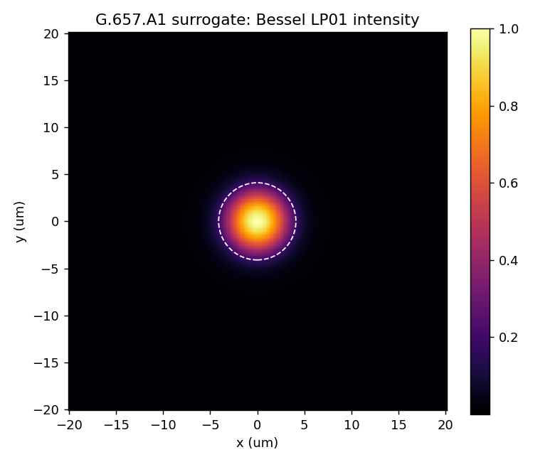
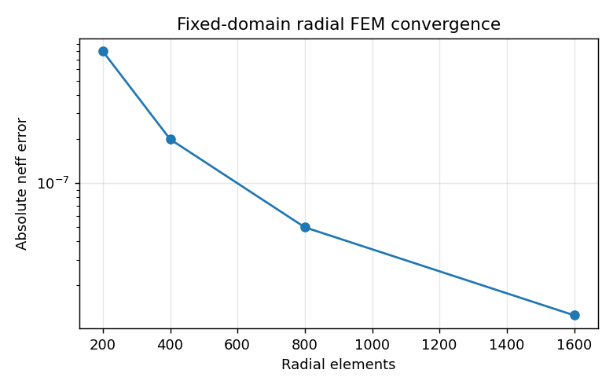
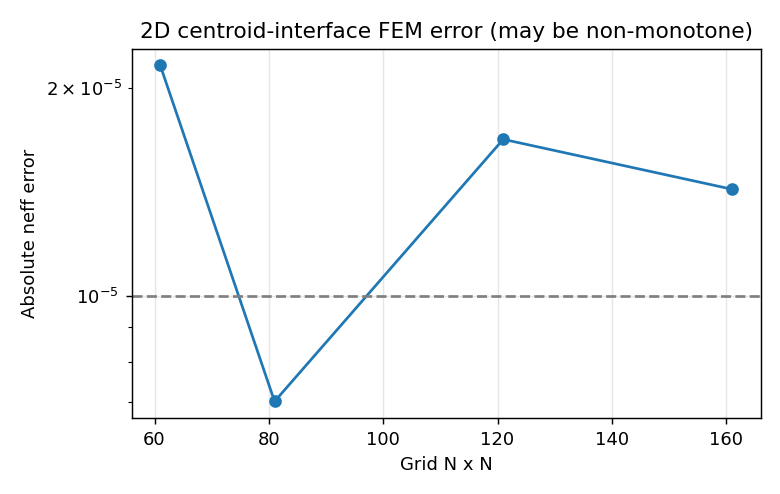
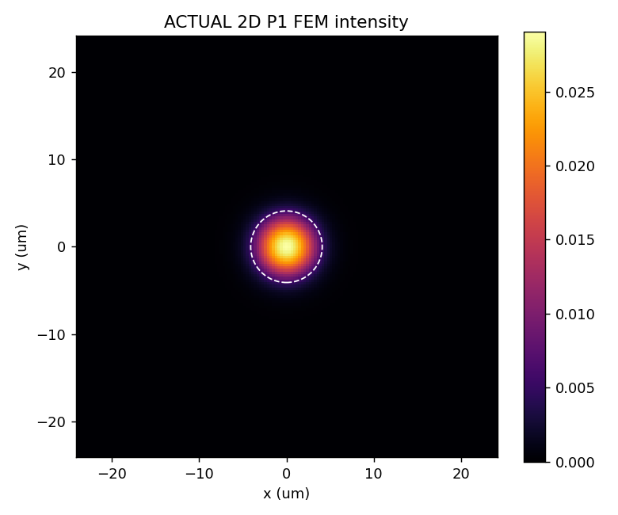
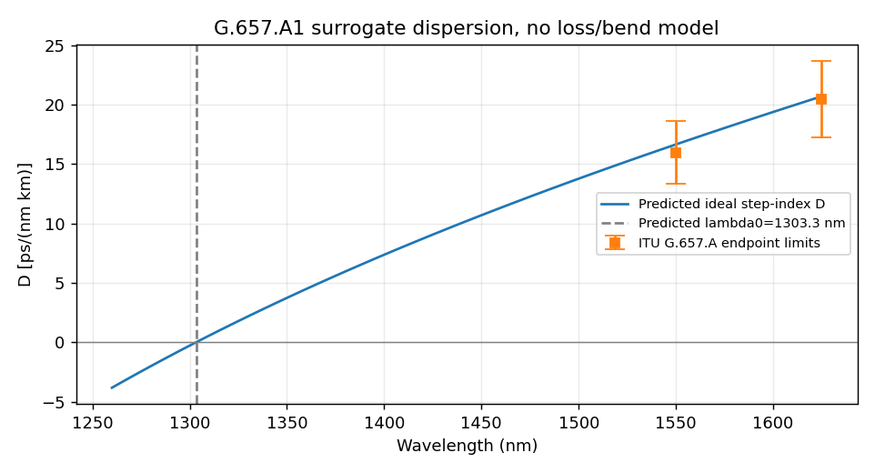

# G.657.A1 / PremierLink A1 참고 단면 — 수치 검증 보고서

[Colab 실행](https://colab.research.google.com/github/kimheeseo/LSCNS/blob/main/COMSOL/g657a1_validation/G657A1_Colab_Validation.ipynb) · [원시 JSON](results/summary.json) · [실행 결과 ZIP](G657A1_Colab_Results.zip)

**2026-10-19 · 수치 검사 11/12 통과, 규격 수치 참고 4/4 범위 내. 제품 인증 또는 COMSOL 동등성 검증이 아닙니다.**

## 모델과 출처

LS 2025 브로셔 p.3의 PremierLink A1/A2 MFD 9.2 µm @1310 nm를 보정 목표로 선택했습니다. 반경 4.1 µm를 가정한 원형 step-index 모델이며, Δn 한 개를 보정했습니다. 같은 MFD로부터 제조사 내부 구조를 유일하게 결정할 수 없습니다. 실제 도핑 분산·trench는 미사용입니다.

- [LS 2025 통신 브로셔](https://fliphtml5.com/plzsm/rgkq/20250925_%ED%86%B5%EC%8B%A0_%EB%B8%8C%EB%A1%9C%EC%85%94/)
- [ITU-T G.657 (08/2024), Table 1](https://www.itu.int/epublications/publication/itu-t-g-657-2024-08-characteristics-of-a-bending-loss-insensitive-single-mode-optical-fibre-and-cable)

## 보정값과 예측값

| 항목 | 값 | 의미 |
|---|---:|---|
| MFD 목표 | 9.2 µm @1310 nm | 입력/보정 목표 |
| 코어 반경 | 4.1 µm | 가정 |
| Δn | 0.0046215295 | MFD 보정 |
| n_eff @1310 | 1.449107548135 | 스칼라 Bessel 기준 |
| MFD Petermann-II @1550 | 10.543027 µm | 모델 예측 |
| Aeff @1310 / @1550 | 66.267872 / 84.459523 µm² | 장 적분 예측 |
| D1550 / D1625 | 16.641833 / 20.687858 ps/(nm·km) | 모델 예측 |
| λ0 / S0 | 1303.2814 nm / 0.0840416 ps/(nm²·km) | 모델 예측 |
| 이상적 LP11 cutoff proxy | 1239.765 nm | 케이블 cutoff 아님 |
| gamma1550 | 1.247880 1/(W·km) | n2=2.6e-20 m²/W 가정 |

## Radial FEM 검증

코어 경계에 메시를 맞춘 radial P1 FEM과 무한 영역 Bessel 해석해를 비교합니다. 메시 수렴 검사는 영역 반경을 40 µm로 고정합니다. 별도 영역 검사에서는 클래딩 간격을 약 0.035 µm로 유지하며 반경을 30/40/50 µm로 바꿉니다.

| 요소 수 | n_eff 절대 오차 | Aeff 상대 오차 (%) | MFD 2차 모멘트 상대 오차 (%) |
|---:|---:|---:|---:|
|200|7.98e-07|0.0376628|0.0213978|
|400|2e-07|0.00941949|0.00534883|
|800|4.99e-08|0.00235513|0.00133716|
|1600|1.25e-08|0.000588799|0.000334274|

## 기존 2D FEM의 실패와 한계

동일 단면에서 삼각형 중심점으로 재료를 분류하는 기존 2D P1 FEM을 재계산했습니다. 161×161 격자의 n_eff 오차는 약 1.43e-5로 엄격한 1e-5 기준에 미달합니다. 오차가 메시와 함께 단조 감소하지 않습니다. 잔차가 작다는 사실은 이산화 정확도를 보장하지 않습니다.

| 격자 N×N | n_eff 절대 오차 | Aeff 오차 (%) |
|---:|---:|---:|
|61|2.16053e-05|1.63571|
|81|7.01539e-06|1.14539|
|121|1.6867e-05|0.113268|
|161|1.42728e-05|-0.0469783|

## 검사별 판정

보정 잔차는 독립 제품 검증 통과 수에 넣지 않았습니다. 수치 정확도 검사와 ITU 표의 수치 범위 참고 비교도 구분합니다.

| 구분 | 검사 | 결과 |
|---|---|---|
|수치|Radial ∣neff error∣ <1e-6|PASS|
|수치|Radial ∣Aeff error∣ <1%|PASS|
|수치|Radial ∣second-moment MFD error∣ <1%|PASS|
|수치|Radial mesh error decreases at every refinement|PASS|
|수치|Radial residual <1e-8|PASS|
|수치|Fixed-spacing domain neff change <1e-7|PASS|
|수치|Fixed-spacing domain Aeff change <0.1%|PASS|
|수치|D1550 derivative-step spread <0.01|PASS|
|수치|2D ∣neff error∣ <1e-5|FAIL|
|수치|2D ∣Aeff error∣ <2%|PASS|
|수치|2D ∣second-moment MFD error∣ <2%|PASS|
|수치|2D residual <1e-8|PASS|
|규격 수치 참고|lambda0 in [1300,1324] nm|PASS|
|규격 수치 참고|S0 in [.073,.092] ps/(nm2 km)|PASS|
|규격 수치 참고|D1550 in [13.3,18.6] ps/(nm km)|PASS|
|규격 수치 참고|D1625 in [17.2,23.7] ps/(nm km)|PASS|

## 미검증 항목

G.657.A1의 굽힘 손실은 현재 직선 모드 솔버로 계산하지 않습니다. 실제 제품의 굽힘 실측, 감쇠, PMD, 케이블 컷오프와 Aeff 비교, 전 벡터 Maxwell/COMSOL 직접 대조가 필요합니다. 규격 범위 안의 λ0·S0·D가 나온 것은 가상 단면의 수치 일관성 참고 결과입니다.

## 노트북 재현 확인

10개 코드 셀을 IPython에서 실제 실행하여 출력과 그림 8개를 저장했습니다. Colab 웹 UI를 수동 검증하지는 않았습니다. 분석 파장을 1550 nm로 바꾼 추가 실행에서 1310 nm 보정 Δn이 변하지 않고, Aeff가 기본 실행의 1550 nm 예측과 일치함을 확인했습니다. 추가 실행에서 생략한 2D·민감도 그림이 ZIP에 섞이지 않는 것도 확인했습니다.

[파라미터 재실행 검증 JSON](results/notebook_validation.json) · [추가 실행 로그](results/parameter_replay.log)

노트북과 `fiber_model.py`의 엔진 해시가 일치하며 저장된 모든 코드 셀에 오류 출력이 없습니다.
