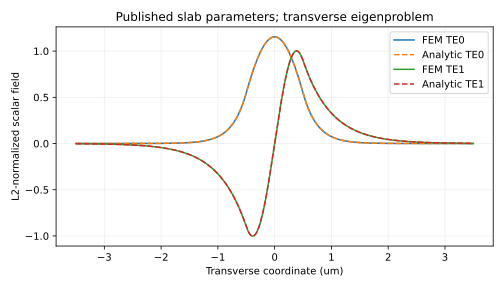
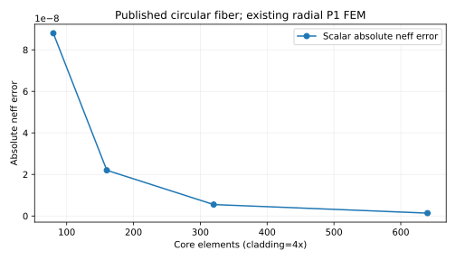
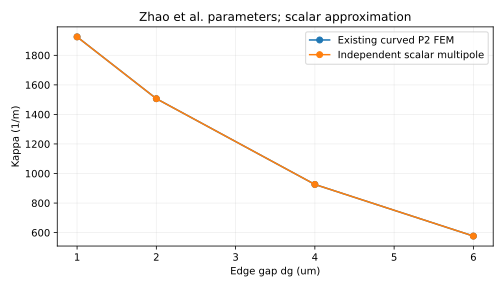
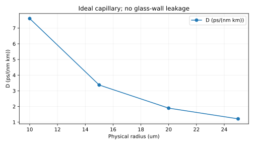

# 공개 레퍼런스 비교 결과: M1 · M7 · MCF · HCF

이 실행의 Python FEM 결과로 자동 생성했습니다. **COMSOL 소프트웨어를 실행하지 않았습니다.** 해석식·독립 기준 오차를 COMSOL 실측 오차로 표시하지 않습니다.

- 실행 UTC: 2026-10-20T21:48:54.746180+00:00
- 소스 커밋: 705eff27821c05431131bf2025170f4d4f6bcd24
- 실행 기록: https://github.com/kimheeseo/LSCNS/actions/runs/39503147864
- 검사 결과: 24/24 통과

## 핵심 수치

| 대상 | 계산값 | 기준 | 오차 |
| --- | --- | --- | --- |
| M1 TE0 | 1.40290981847 | published analytical equation; not COMSOL export | 1.75736e-06 (absolute neff) |
| M7 LP01 | 1.44440184303 | independent scalar circular equation | 1.37502e-09 (absolute neff) |
| MCF | 1506.35165 | independent scalar multipole; not published COMSOL | 1.41858e-05 (relative percent) |
| HCF | 0.999487812283 | published capillary approximation; not full COMSOL | 1.70787e-10 (absolute neff) |

## M1 슬랩

공식 C1 조건: n_core=1.5, n_clad=1, 전두께 1 µm, λ=1.55 µm, 전체 횡단면 7 µm(양쪽 padding=3 µm). 기존 M1 TE 해석기를 실행했습니다. 비교는 횡단면 고유문제이며 공식 예제의 포트·전파 해석은 대상이 아닙니다.

| 모드 | h (µm) | FEM neff | 독립 해석 neff | 절대 오차 | 장 상대 L2 오차 |
| --- | --- | --- | --- | --- | --- |
| TE0 | 0.04 | 1.402799089590 | 1.402911575826 | 0.00011249 | 0.0006387 |
| TE1 | 0.04 | 1.115726867072 | 1.116344006843 | 0.00061714 | 0.0028276 |
| TE0 | 0.02 | 1.402883457260 | 1.402911575826 | 2.8119e-05 | 0.00015974 |
| TE1 | 0.02 | 1.116188848302 | 1.116344006843 | 0.00015516 | 0.0016048 |
| TE0 | 0.01 | 1.402904546367 | 1.402911575826 | 7.0295e-06 | 3.9975e-05 |
| TE1 | 0.01 | 1.116304450351 | 1.116344006843 | 3.9556e-05 | 0.0015145 |
| TE0 | 0.005 | 1.402909818470 | 1.402911575826 | 1.7574e-06 | 1.0136e-05 |
| TE1 | 0.005 | 1.116333357508 | 1.116344006843 | 1.0649e-05 | 0.0015133 |

**문서 불일치:** 공식 설명의 TE0만 전파한다는 문장은 주어진 전두께·굴절률의 일반적 모드 개수와 맞지 않습니다. 반두께 기준 V≈2.266>π/2이므로 TE0·TE1이 존재하며 FEM과 독립 분산식으로 확인했습니다. TE0 입사와 다른 유도 모드가 존재하지 않는 것은 구분해야 합니다. 이 문구를 맞추기 위해 모드를 삭제하지 않았습니다. TE1은 같은 padding에서 더 약하게 감쇠해 경계 영향이 클 수 있습니다.

## M7 원형 광섬유

공식 C2의 코어 반경 8 µm, 외곽 40 µm, n_core=1.4457, n_clad=1.4378, λ=1550 nm를 기존 Fiber API와 radial FEM에 전달했습니다. LP01 별도 스칼라 기준식을 첫 J0 분기에서 풀어 V>2.405 기본 모드를 비교했습니다. 기존 UI/오라클 제한은 바꾸지 않았습니다.

- 실제 V: 4.894537730
- 스칼라 LP01 기준 neff: 1.444401844409
- 벡터 HE11 특성방정식 neff: 1.444399445407
- 스칼라/벡터 모델 차이: 2.399e-06 (절대), 0.00016609%
- 공식 공개값은 **1.4444**로 소수점 네 자리입니다. 원시 수치가 없어 정밀 COMSOL 오차율은 산출하지 않았습니다. 반올림 구간 검사는 최근접 반올림을 가정한 참고 검사입니다.
- 벡터 값은 독립 원형 Maxwell 특성방정식 계산입니다. 새 벡터 FEM이나 COMSOL 실행 결과가 아닙니다.

| 코어/클래딩 요소 | FEM neff | 스칼라 절대 오차 |
| --- | --- | --- |
| 80/320 | 1.444401756428 | 8.79814e-08 |
| 160/640 | 1.444401822410 | 2.19991e-08 |
| 320/1280 | 1.444401838909 | 5.50002e-09 |
| 640/2560 | 1.444401843034 | 1.37502e-09 |

## MCF 2코어

P1의 a=3.5 µm, n_clad=1.444, λ=1550 nm, 상대 Δ=0.25%, 가장자리 간격 dg=2 µm를 사용했습니다. 중심 간격 p=2a+dg=9 µm. 기본 변환은 Δ=(n_core²−n_clad²)/(2n_core²)를 가정하며, 원문 변환식이 명확하지 않아 대안의 민감도를 함께 계산했습니다.

- 변환 n_core=1.447623594154, 절대 Δn=0.003623594154
- 곡선 P2 FEM을 독립 무한 클래딩 Fourier–Bessel 경계 정합과 비교했습니다. 논문 벡터/편광·경계·메시와 완전히 동일하다는 주장은 하지 않습니다.
- Figure 2의 간격 증가 → κ 감소 경향을 재현했습니다. 그래프를 정밀 디지타이즈하지 않았고 원시 β/κ 표가 없어 **논문 COMSOL 대비 정밀 오차율은 미산출**입니다.

| h (µm) | κ (1/m) | Lc (mm) | 독립 스칼라 κ 오차 (%) |
| --- | --- | --- | --- |
| 1.0 | 1506.484263520 | 1.042690166 | 0.00881781 |
| 0.7 | 1506.481892933 | 1.042691807 | 0.00866044 |
| 0.5 | 1506.481253767 | 1.042692249 | 0.00861801 |
| 0.35 | 1506.481448380 | 1.042692114 | 0.00863093 |

| Δ 가정 | n_core | κ (1/m) | 기본 가정 대비 κ 차이 (%) |
| --- | --- | --- | --- |
| squared_index_primary | 1.447623594154 | 1506.351436314 | 0 |
| linear_relative_to_cladding | 1.447610000000 | 1504.823255937 | 0.101449 |
| linear_relative_to_core | 1.447619047619 | 1505.845012446 | 0.0336192 |

**경계 영향 추가 확인:** L=40 µm에서 h를 줄여도 오차가 약 0.0086%에 머물렀습니다. 같은 h=0.35 µm로 L을 48/56/64 µm까지 늘려 독립 기준에 접근하는지 확인했습니다. 아래는 메시 세분화와 별도로 수행한 계산영역 확대 결과입니다. 기존 UI의 영역 제한은 변경하지 않았습니다.

| L (µm) | h (µm) | κ (1/m) | Lc (mm) | 독립 스칼라 κ 오차 (%) |
| --- | --- | --- | --- | --- |
| 48.0 | 0.35 | 1506.367087813 | 1.042771274 | 0.00103903 |
| 56.0 | 0.35 | 1506.353329254 | 1.042780798 | 0.000125664 |
| 64.0 | 0.35 | 1506.351650002 | 1.042781961 | 1.41858e-05 |

## HCF

H1 Eq.(1)의 모세관 근사 neff=sqrt(n_gas²−(u01·λ/(2πR))²)를 기준으로 기존 radial P1 FEM을 검증했습니다. R=15 µm·λ=1550 nm·일정 n_gas=1.00027은 선택한 검증 입력이며 논문의 실제 AR-HCF 단면·압력을 재현한 것이 아닙니다. Aeff는 J0 적분, D는 같은 식을 일정 n_gas로 미분한 기준입니다.

| 요소 | FEM neff | neff 절대 오차 | Aeff (µm²) | Aeff 오차 (%) | D | D 오차 (%) |
| --- | --- | --- | --- | --- | --- | --- |
| 80 | 0.999487801532 | 1.09219e-08 | 336.85981205 | 0.000950507 | 3.373214457 | 0.00139906 |
| 160 | 0.999487809722 | 2.73203e-09 | 336.86221498 | 0.000237181 | 3.373179070 | 0.000349964 |
| 320 | 0.999487811771 | 6.83116e-10 | 336.86281432 | 5.92619e-05 | 3.373170216 | 8.75049e-05 |
| 640 | 0.999487812283 | 1.70787e-10 | 336.86296405 | 1.4813e-05 | 3.373168003 | 2.18772e-05 |

**전체 HCF COMSOL 비교 미지원:** 현재 유리벽·반공진·PML·복소 neff가 없어 구속 손실이나 실제 NANF/ARF 오차율을 계산할 수 없습니다. C3의 유리 코어 미세구조 예제도 구조가 달라 비교에서 제외했습니다. 반경 변경은 물리 구조 변경이며 영역 수렴이 아닙니다.

## 오차 원인과 사용 범위

- 메시 의존성은 이산화와 외곽 경계 절단의 수치 오차입니다. 각 CSV에 메시/영역 변화를 분리했습니다. M7 영역 비교는 클래딩 요소 간격을 일정하게 유지합니다.
- M7 스칼라/벡터 차이는 Maxwell 계면 조건을 약도파 근사로 줄인 모델 차이이며 메시만 늘려 제거할 수 없습니다.
- MCF는 상대 Δ 정의·벡터/스칼라·원시 수치 부재가 남습니다. 독립 스칼라 오차를 논문 오차로 부르지 않습니다.
- HCF 모세관 검증은 유리벽 반공진 구조의 검증이 아닙니다.
- 실행 시간은 이 러너의 Python 시간만 JSON/CSV에 기록했습니다. 동일 하드웨어·정확도 COMSOL 자료가 없어 속도/메모리 우열은 판단하지 않습니다.
- 이 조건의 검증은 G.654.E/G.657.A1 제품 인증·굽힘·감쇠·PMD·케이블 누화 정확도 보증이 아닙니다.

## 출처·재현·검사

[출처 전체](../references.json) · [실행법](../README.md) · [수치/환경/해시](comparison.json) · [CSV 요약](summary.csv)

| 검사 | 통과 |
| --- | --- |
| M1 mode count h=0.04 | True |
| M1 mode count h=0.02 | True |
| M1 mode count h=0.01 | True |
| M1 mode count h=0.005 | True |
| M1 TE0 finest absolute error <1e-5 | True |
| M1 TE0 field relative L2 <2e-4 | True |
| M1 TE0 mesh error decreases | True |
| M1 TE0 padding5->7 change <1e-9 | True |
| M7 weak contrast vector/scalar limit <1e-7 | True |
| M7 finest scalar absolute error <1e-8 | True |
| M7 mesh error decreases | True |
| M7 vector matches printed rounding interval (assumed nearest) | True |
| M7 vector characteristic residual <1e-10 | True |
| M7 R40->48 neff change <1e-9 | True |
| MCF expanded L56->64 kappa change <0.001% | True |
| MCF expanded L64 kappa error <0.001% | True |
| MCF angular order8->10 kappa change <0.01% | True |
| MCF finest scalar kappa error <0.1% | True |
| MCF L36->40 kappa change <0.1% | True |
| MCF published trend kappa decreases with edge gap | True |
| HCF N640 neff absolute error <1e-9 | True |
| HCF N640 Aeff error <0.0001% | True |
| HCF N640 D error <0.0001% | True |
| HCF mesh neff error decreases | True |

## 논문 MCF 그림 수치 추출 검토

원시 COMSOL 수치표가 없어 Figure 2(a)의 녹색 FEM 곡선을 이미지 좌표로 추출했습니다. 축 보정과 원본 PDF 해시는 mcf_graph_estimates.json에 기록합니다. 그림 오차는 근사값이며 모델/Δ 정의/편광 차이를 포함한 엄밀한 수치 오차가 아닙니다.

추출 상태: unavailable

자동 그림 추출을 완료하지 못했습니다. 원인: Insufficient green curve pixels; 정밀 논문 오차율은 미산출입니다.
