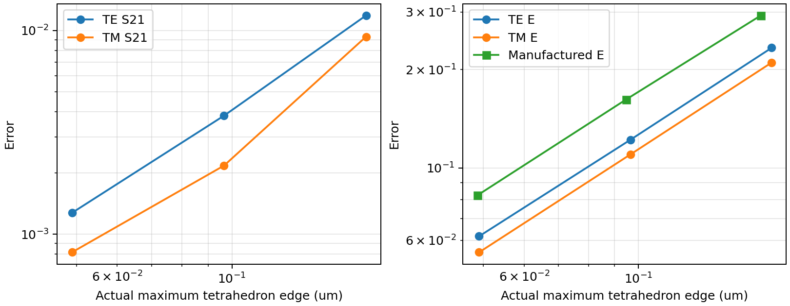
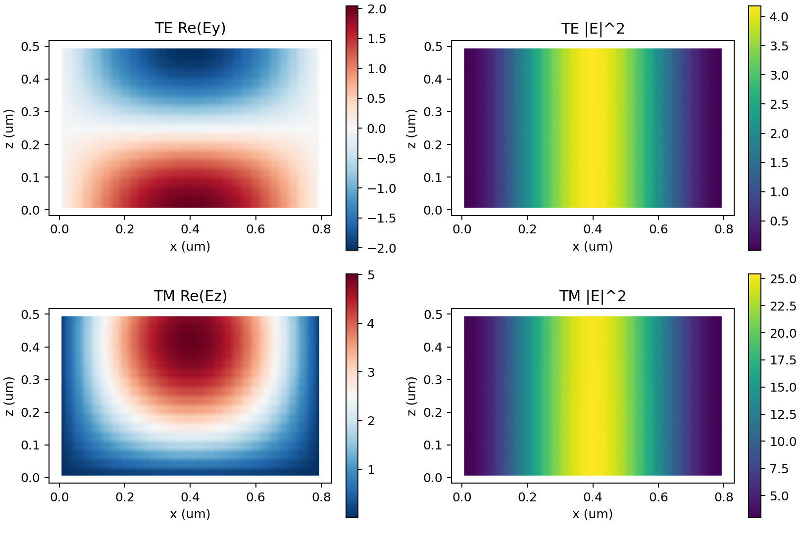
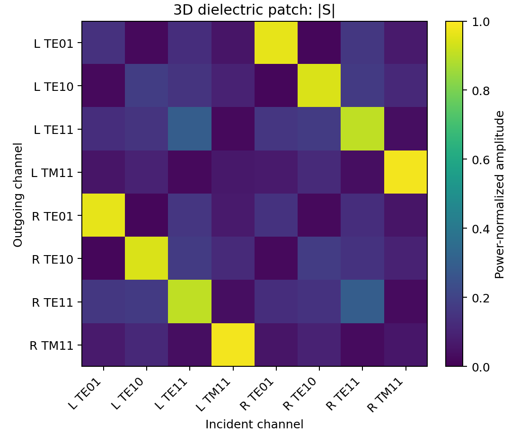

# M4 3D Maxwell 결과 보고서와 첨부사진 검증

2026-10-11 실제 실행 자료입니다. 기존 M4 104개 시험은 핵심 12개와 회귀·추가 92개의 중복 없는 분리 실행 결과이며, 사진 기준 추가 검사 9개는 별도 FEM 측정 후 판정했습니다.

- [12쪽 Word 결과 보고서](M4_3D_Maxwell_Analysis_Report.docx)
- [M4 정식화·실패 원인·세 메시 수렴·원시 수치](M4_VALIDATION_REPORT.md)
- [첨부사진 기준 추가 검증 결과](PHOTO_VALIDATION_REPORT.md)
- [재현 소스와 테스트 및 원시 로그 ZIP](M4_Reproducibility_Source.zip)
- [M4 원시 측정 JSON](results/validation_m4.json) · [추가 검증 JSON](audit/photo_validation.json)
- [세 메시 CSV](results/convergence_m4.csv) · [추가 시험 계약](audit/CRITERIA.md)

ZIP에는 M1–M4 소스·독립 해석 oracle·테스트·JSON·CSV·pytest XML·초기 실패 로그가 포함되어 있습니다. 큰 필드 NPZ와 그림은 ZIP에서 제외했으며 `validate_m4.py`로 재생성합니다. 아래 그림은 실제 실행 결과입니다.

## 현재 저장소 구현과의 관계

기존 `COMSOL/waveoptics_m4`의 PEC 공동 고유모드 재구현은 유지했습니다. 이 폴더의 ZIP은 이전 전체 3D 주파수 영역 Nédélec·PML·직사각형 포트·S 행렬 구현 및 검증 증빙을 별도로 제공합니다. 이번 공동 검사는 기존 저장소 소스를 다시 실행한 결과이며, 기본 메시의 0.307% 실패와 추가 세분화 메시의 0.0286% 통과를 구분합니다. M5–M8이나 웹 UI 구현은 변경하지 않았습니다.

## 검증 범위

사진 기준 슬랩 상대 n_eff<1e-6, 정확한 벡터 HE11 절대 n_eff<1e-4, M3 층 R/T<1e-3, 2D 원통 산란 폭<1%, PEC 공동 주파수<0.1%를 지정 메시에서 충족했습니다. 에너지 보존·S 상반성·직사각형 포트 직교성·새 파장 1.13 µm·TE PML 두께와 차수의 세 조합도 확인했습니다.

3D 구 Mie 산란, 임의 구조의 전체 스퓨리어스 고유모드 배제와 완전성, PML 두께·차수 각각의 독립 sweep, 사람 또는 별도 모델의 독립 검토, 실제 COMSOL 직접 대조는 미검증입니다. 사진 요구사항 전체 통과나 상용 정확도를 주장하지 않습니다.

## 실제 실행 그림

