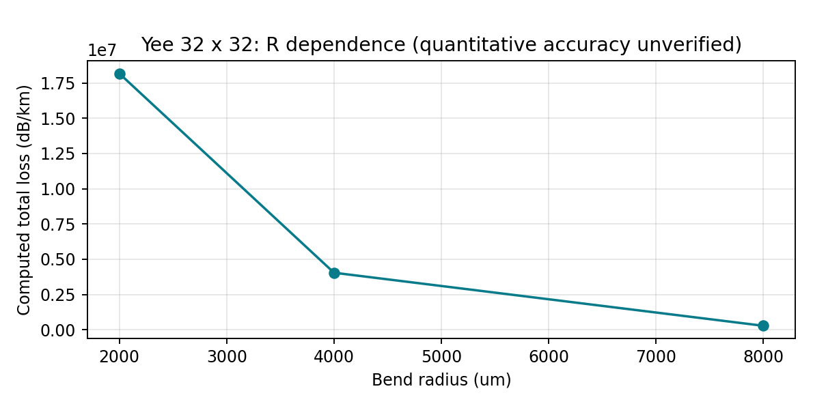
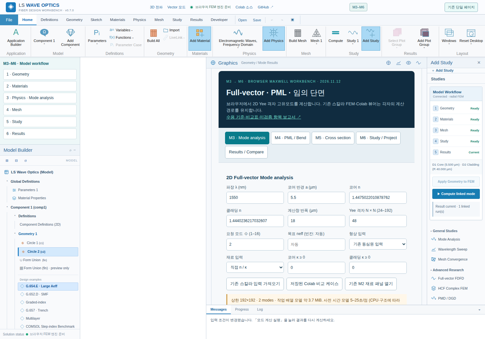

# M3–M6 브라우저 Full-vector 업데이트 · 검증 보고서

2026-11-12 · 구현 버전 1.0 experimental. 수치해석 연구용이며 모든 수용 기준을 통과한 버전이라는 의미가 아닙니다.

## 구현과 검증 상태

| 단계 | 기능 | 수용 상태 |
| --- | --- | --- |
| M3 | Yee 벡터 FDFD, Worker, 취소, 복수 모드, 복소 Ex/Ey/Ez, 편광/MFD/Aeff, JSON | 구현. M1·scalar·기존 Python 차이 표 제공. 마지막 격자 간 neff 수렴 기준은 미통과 |
| M4 | 복소 stretching PML, M2 κ/α, 등가 굽힘, NANF 재사용, 모드 후보 제외 | 구현. PML 손실 수렴 미통과. HCF 손실은 벽 해상도 부족으로 미검증 |
| M5 | 폴리곤/영역 재료, SVG 래스터화, 이미지 색상 마스크, subpixel, 직접 N코어 | 구현. 원형 격자 경로 동일. 마스크/MCF 오차 표 제공 |
| M6 | 기존 패널 연결 tree, 1–2축 sweep, 이력/overlay, 프로젝트 schema3, 구버전 이관, UI 복귀 | 구현. 브라우저 프로젝트 파일 왕복·scalar/CAD/Parameters 복원·2축 스윕 CSV·취소·구버전 이관·UI 복귀 검사 통과 |

## 수치 방법과 물리 범위

Cartesian Yee FDFD를 선택했습니다. 이미지와 임의 단면을 같은 ε 격자로 변환하고, staggered Maxwell curl의 각 미분에 PML stretching을 적용할 수 있기 때문입니다. 기존 collocated Hx/Hy FDFD와 radial scalar FEM은 수정하지 않았습니다.

전파 규약: $e^{i\beta z-i\omega t}$, $\tilde n=n+i\kappa$. $k_0=2\pi/\lambda$, 브라우저 내부 길이는 µm. 횡방향 전기장의 $PQE_t=n_\mathrm{eff}^2E_t$를 풉니다. $D^+,D^-$를 staggered 전/후방 차분이라 하면:

$$C_E=D_x^+E_y-D_y^+E_x,\quad Q E=(-D_x^-C_E-\epsilon_yE_y,\;-D_y^-C_E+\epsilon_xE_x).$$

$$C_H=D_x^-H_y-D_y^-H_x,\quad P H=(D_x^+\epsilon_z^{-1}C_H+H_y,\;D_y^+\epsilon_z^{-1}C_H-H_x).$$

P와 Q의 곱을 국소 stencil로 전개한 sparse CSR과 직접 Maxwell curl 적용값의 차이는 독립 테스트에서 10⁻¹² 미만입니다. Block shift-invert + ILU(0)-GMRES(restart 36) + Rayleigh–Ritz를 사용합니다. 외측 상대 고유값 잔차는 기본 10⁻⁸, PML/흡수 시 10⁻¹⁰; 내측 실제 잔차는 min(2×10⁻¹⁰, 외측 허용값×0.02). 최대 120회 외측·1400회 선형 반복입니다. 요청 모드가 수렴하지 않으면 해당 점을 FAILED로 반환합니다.

상한: 축당 24–192셀, 1–16모드, 스윕 전체 36점. 고유값 계산은 Worker에서 실행하며 취소는 Worker.terminate로 즉시 종료합니다. 사전 시간·메모리는 추정으로, 실행 후 performance.now()와 가능한 heap API 실측은 따로 표시합니다.

## M3: step-index 격자·M1·scalar FEM 비교

λ=1550 nm, a=4.1 µm, n_clad=1.444023621703261, Δn=0.005, 계산창 반폭18 µm, subpixel 4×4. M1은 약유도 LP01 해석해이며 정확한 벡터 HE11 해와 동일하지 않습니다. Scalar FEM은1000요소, 외곽반경40 µm입니다.

| N | Yee neff | M1 LP01 | scalar FEM | Δ M1 | 실측 s | Process RSS MiB | 배열 추정 MiB |
| --- | --- | --- | --- | --- | --- | --- | --- |
| 24 | 1.44608547856 | 1.44610478058 | 1.44610475118 | -1.93020245067e-05 | 0.363624669 | 61.08984375 | 1.42401504517 |
| 48 | 1.44610494867 | 1.44610478058 | 1.44610475118 | 1.68092116448e-07 | 2.817283409 | 87.328125 | 5.69458389282 |
| 72 | 1.44609935051 | 1.44610478058 | 1.44610475118 | -5.43006791176e-06 | 11.526686453 | 123.76171875 | 12.8133583069 |
| 96 | 1.44610489953 | 1.44610478058 | 1.44610475118 | 1.1894574059e-07 | 20.954853124 | 168.14453125 | 22.7819862366 |


96셀의 M1 차이=1.189e-07.마지막 두 격자 차이=5.549e-06>10⁻⁶이므로 **격자 수렴은 미통과**입니다. 경계 샘플링에 따른 비단조 변동이 있습니다.

메모리 RSS는 Node 전체 프로세스 실측으로 런타임·누적 캐시·다른 테스트 데이터까지 포함합니다. 개별 Worker 전용 heap 실측이 아닙니다. 배열 모델은 추정치입니다. 브라우저 heap API가 미지원이면 ‘실측 미지원’으로 표시합니다.

환경: Node v24.22.1, AMD EPYC 9V74 80-Core Processor, linux.

## 기존 Colab/Python 결과 비교

저장된 Python 결과는 collocated Hx/Hy FDFD이며 Yee와 이산화 방식이 다릅니다. 같은 물리 입력을 비교했으며 동일 격자 알고리즘 일치라고 주장하지 않습니다. Python 69점, a5.5 µm, Δn=0.0034785793846155, 반폭22 µm.

| Yee N | Yee neff | 기존 Python neff | 차이 |
| --- | --- | --- | --- |
| 48 | 1.4457134495 | 1.44571188851 | 1.56098615745e-06 |
| 68 | 1.44571882877 | 1.44571188851 | 6.94026468495e-06 |
| 96 | 1.44571573505 | 1.44571188851 | 3.84654025676e-06 |


별도 동일 Yee 행렬을 SciPy sparse ARPACK eigs로 계산한 N24 결과와 JS GMRES/Ritz의 차이는 약9.5×10⁻¹³입니다. 이는 고유값 알고리즘 교차 검사이며 독립적인 연속체 Maxwell 검증은 아닙니다. 원자료: scipy_oracle.json.

## M4: 손실식·PML 수렴

$$\alpha_\mathrm{total}[\mathrm{dB/km}]=\frac{20}{\ln 10}\frac{2\pi}{\lambda[\mathrm m]}\,\mathrm{Im}(n_\mathrm{eff})\times1000.$$

$s_x=1+i\sigma_\max t_x^m$, $s_y=1+i\sigma_\max t_y^m$, $D\to s^{-1}D$. 굽힘은 $\tilde n_\mathrm{bend}=\tilde n\exp(x/R)$인 등방성 등가 굴절률 근사입니다. 완전한 곡선 좌표 벡터 변환은 아닙니다. $\mathrm{dB/turn}=\alpha_\mathrm{total}\,2\pi R[\mu m]\times10^{-9}$. κ≠0이면 흡수와 복사가 함께 들어갑니다. κ=0, 직선 R=0 결과를 각각 따로 계산하여 차이를 보고합니다.

N48, 반폭18 µm, step-index의 거의 무손실인 직선 케이스입니다. 고유 잔차가 작아도 작은 허수부의 상대오차가 클 수 있습니다. 음수 손실은 절댓값으로 바꾸지 않고 그대로 보입니다.

| 두께 µm | 강도 | Im neff | dB/km | 잔차 | 판정 |
| --- | --- | --- | --- | --- | --- |
| 3 | 1 | -2.76148605433e-11 | -0.972311296512 | 2.06980181666e-11 | 미수렴 / 미검증 |
| 3 | 3 | 4.8937578058e-11 | 1.72307804688 | 2.19495603609e-11 | 미수렴 / 미검증 |
| 3 | 5 | 4.24955770373e-10 | 14.9625704394 | 2.82076845661e-11 | 미수렴 / 미검증 |
| 4 | 1 | -1.62049833346e-11 | -0.570572801964 | 1.98040478127e-11 | 미수렴 / 미검증 |
| 4 | 3 | 1.46959496528e-10 | 5.17440160091 | 2.27906828625e-11 | 미수렴 / 미검증 |
| 4 | 5 | 1.64867324219e-10 | 5.80493106285 | 3.5383451427e-11 | 미수렴 / 미검증 |
| 5 | 1 | -5.0849572492e-12 | -0.179039882093 | 2.09528318983e-11 | 미수렴 / 미검증 |
| 5 | 3 | 1.82565802215e-10 | 6.42808938224 | 2.59693608619e-11 | 미수렴 / 미검증 |
| 5 | 5 | -2.19910538578e-10 | -7.74298680766 | 4.49055637984e-11 | 미수렴 / 미검증 |


설정에 따라 부호까지 변하므로 이 작은 직선 누설손실은 정량 검증되지 않았습니다. 잔차 기반 손실 민감도는 엄밀한 오차 상한이 아니며 비정규 고유값 민감도를 보증하지 않습니다.

가짜 모드 후보는 PML |E|² 비율>35%, 물리영역<65%, 음의 Im(neff)<−10⁻⁸, 잔차 초과로 제외합니다. 이 비율은 에너지 정규화에 의한 완전한 물리성 증명이 아닙니다. 물리 영역의 코어 필드·계산창·PML 변화에도 안정적인 모드인지 확인해야 합니다.

## 굽힘 R 의존성

| R µm | Re neff | dB/km | dB/turn | 상태 |
| --- | --- | --- | --- | --- |
| 8000 | 1.44621588735 | 280294.345128 | 14.089130488 | 고유 잔차 통과; 정량 손실 미검증 |
| 4000 | 1.4464450554 | 4041977.16239 | 101.585966075 | 고유 잔차 통과; 정량 손실 미검증 |
| 2000 | 1.44699097213 | 18166675.0835 | 228.28917193 | 고유 잔차 통과; 정량 손실 미검증 |
| 1000 | 미검증 | 미검증 | 미검증 | Eigenproblem did not converge all requested modes; best residuals: 1.81e-11, 1.89e-10 |


현재 자동 shift는 직선 M1 LP01 neff를 목표로 합니다. benchmark.json의 초기 굽힘 행은 최대 굴절률 부근 shift에서 PML 모드가 선택될 수 있음을 보여주는 이전 실행 기록입니다. 현재 R 검사는 bend_target_validation.json이 기준입니다. 성공한 R점에서 반경 감소 시 손실 증가가 관찰되며, 실패 지점에는 수치를 대체하지 않았습니다.



## HCF/NANF: 기존 Colab 비교

기존 hcf_complex_fem 결과는 Full-vector가 아닌 scalar P1 삼각형 FEM/PML 예비 결과입니다. 같은6튜브2중 설계·1550 nm를 대조하되 메시·계산창·PML·물리식·모드 식별이 다릅니다. 정량 일치로 해석하지 마세요.

| Yee N | Re neff | Im neff | dB/km | 기존 scalar Colab Re neff | 차이 | 상태 |
| --- | --- | --- | --- | --- | --- | --- |
| 48 | 0.999646324691 | 7.71385619059e-16 | 2.71602657635e-05 | 0.999704742087 | -5.84173962282e-05 | 미검증: 벽<3셀, PML/mesh 수렴 미통과 |
| 72 | 0.999668380221 | 2.31471571441e-12 | 0.081500474493 | 0.999704742087 | -3.63618660834e-05 | 미검증: 벽<3셀, PML/mesh 수렴 미통과 |


벽 두께 최소0.45 µm에 비해 h=1.5–2.25 µm이므로 벽을 분해하지 못합니다. subpixel은 이를 대체하는 정확도 증명이 아닙니다. 기본 설계의 정량 HCF 손실 수용 기준은 **미달**입니다. 기존 입력 재사용에는 재킷이 없는 튜브 기하만 포함되며 사용자가 재킷을 원하면 영역/마스크로 추가해야 합니다.

## M5: 원형·마스크·subpixel

circle region은 radial step-index와 동일 sampling 함수를 사용하므로 같은 N48에서 neff가 수치적으로 같습니다. 이산 이미지 마스크는 픽셀 경계 오차가 더해집니다.

| 입력 | neff | Δ radial step N48 | Aeff µm² |
| --- | --- | --- | --- |
| circle-region | 1.44610494867 | 0 | 79.6980411081 |
| circle-mask-128 | 1.44612387177 | 1.89230933538e-05 | 80.0274628446 |
| circle-mask-256 | 1.44611115149 | 6.20281588226e-06 | 79.7762678111 |
| circle-mask-512 | 1.44610391489 | -1.0337848102e-06 | 79.7103182219 |
| subpixel-false | 1.4461163391 | 1.1390426625e-05 | 79.5357497487 |
| subpixel-true | 1.44610494867 | 0 | 79.6980411081 |


SVG는 외부 참조·스크립트·애니메이션을 거부한 뒤 최대512px 마스크로 래스터화합니다. SVG 곡선이 직접 경계 정합 FEM 메시가 되는 것은 아닙니다. 이미지 물리 폭/높이와 각 색상 재료는 사용자가 지정합니다.

## MCF 직접 해석과 기존2코어 참조 보간

a4.1 µm, Δn0.005,1550 nm,pitch16 µm,반폭30 µm. Ex 우세 초모드2개를 쌍으로 비교합니다. 기존 scalar 참조값과 vector 분리의 차이입니다.

| N | 직접 Δneff | 기존 보간 Δneff | 차이 | κ /m | Lc mm | L1mm XT dB |
| --- | --- | --- | --- | --- | --- | --- |
| 48 | 7.26282617889e-05 | 7.42779762297e-05 | -1.64971444083e-06 | 147.20542818 | 10.6707772004 | -16.5784648847 |
| 72 | 7.27416903572e-05 | 7.42779762297e-05 | -1.53628587252e-06 | 147.435329055 | 10.654137898 | -16.5647119866 |
| 96 | 7.34283963117e-05 | 7.42779762297e-05 | -8.49579917972e-07 | 148.827168012 | 10.5544998792 | -16.481892685 |


N코어는 중심+육각 배치로 직접 생성합니다. 완전한 한 편광의 N개 모드를 얻으면 코어 내부 Ex 평균으로 U를 만들고 H=U diag(β) U⁻¹의 비대각 항 및 코어 투영 전파를 계산합니다. 모드 수 부족이나 나쁜 조건수는 미검증으로 거부합니다. 이 reduced coherent 모델의 기저 수렴은 별도 검증해야 하며 실제 랜덤 케이블 XT가 아닙니다.

## M6: 저장·불러오기와 검증 한계

- 프로젝트 schema3: 기존 입력·스칼라 결과, Parameters, CAD feature/selection, Materials, PML editor, M2 모델, Yee 구성·마스크·영역·필드 결과·참조·최대5개 이력·스윕 축·UI 상태를 묶습니다.
- 구버전 {version,model}을 이관하며 존재하지 않는 CAD/M2/PML/이력은 경고합니다. 미래 schema는 거부합니다.
- 기본 scalar solver의 수식은 변경하지 않았습니다. M20% 도핑의1ulp 차이는 순수 실리카 함수를 재사용하도록 정리했고, 기존 M2 UI의 parseIndexTable import 오류를 수정했습니다.
- 브라우저에서 N24 Worker 계산, 결과 표/필드 생성, 프로젝트 JSON·CSV 다운로드를 확인했습니다. export된 JSON에서 Parameters/CAD/Materials/PML/M2 상태와 neff를 확인했습니다.
- 프로젝트 왕복 codec·구버전 이관·CSV escaping·2축 작업 확장은 자동 테스트 통과입니다. 별도 Chromium 검사에서 실제 프로젝트 JSON 다운로드→재업로드 후 vector 필드/neff, scalar 결과, CAD/Parameters 복원을 확인했습니다. 2축4점 스윕 CSV, 취소, 원형 영역 동일성, 구버전 JSON, UI 복귀도 통과했습니다. [브라우저 수용 검사 실행 기록](https://github.com/kimheeseo/LSCNS/actions/runs/43149295306). JSON 붙여넣기는 별도 보조 경로입니다.
- URL ?workflow=legacy 또는 상단 기존 단일 페이지 버튼, window.LSWaveFeatures.vectorWorkbench=false 기능 플래그를 제공합니다. UI 복귀 전후 scalar 입력 수식은 같습니다.

## 재현

```bash
node tests/test_yee.mjs
node tests/test_vector_m3.mjs
node tests/test_m3_study_v07.mjs
node tests/test_m2_preview_v06.mjs
node tests/benchmark_yee.mjs
```

benchmark_yee.mjs는33개 계산을 재실행하며 브라우저보다 Node에서 더 빠를 수 있습니다. JSON 원자료에는 성공/실패,잔차,실측시간,process메모리,배열추정이 들어 있습니다. 마스크 labels는 보고서에서 SHA256과 생성식으로 축약했습니다.

## 참고 근거

- [Fallahkhair, Li, Murphy, JLT2008 벡터 유한차분](https://doi.org/10.1109/JLT.2008.923643)
- [Murphy modesolver: Yee staggered formulation and layout sampling](https://github.com/thomas-e-murphy/modesolver)
- [COMSOL PML implementation: complex stretching](https://doc.comsol.com/6.3/doc/com.comsol.help.comsol/comsol_ref_definitions.21.132.html)

이 구현은 위 라이브러리 코드를 복사한 포트가 아니라 명시한 이산 Maxwell curl로 구현한 별도 연구 프로토타입입니다.

## 검증된 UI 화면


