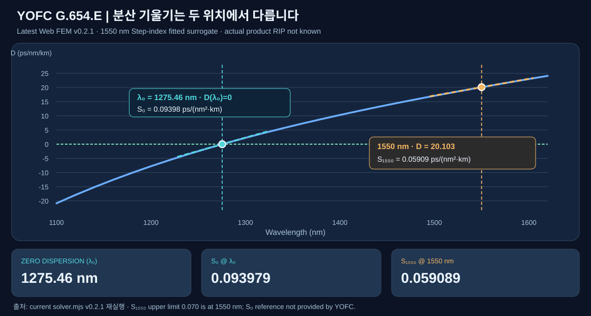

# COMSOL validation report index

## 2026-11-18 — STEP 0 감사 승인 및 STEP 1–3 연구용 광섬유 설계/솔버 확장

- **[STEP 0 승인·STEP 1–3 검증 수용 기준](./STEP0_APPROVAL_STEP1_3_ACCEPTANCE_20261118.md)** — 기존 감사 결과 보존과 향후 정확도 기준.
- **[STEP 1–3 실제 구현 상태·CI 검증 기록](./STEP1_3_IMPLEMENTATION_STATUS_20261118.md)** — 25개 JSON 프리셋, Gmsh 메시, mixed HCurl/H1 풀벡터 Python 스모크 테스트 9/9 성공, 수치·물리적 미검증 항목 명시.
- [Python 연구용 독립 엔진](../universal_silica_v01/fiber_research_v1/) / [기존 웹의 독립 결과 뷰어](../universal_silica_v01/web/) — 기존 M1–M6 스칼라/Yee 기능 및 프로젝트 파일 경로 유지.
- [GitHub Actions 실행](https://github.com/kimheeseo/LSCNS/actions/runs/44133166704) — gmsh/scikit-fem/CLI 스모크 테스트. **광학적 정밀도나 PML 누설손실 검증 합격을 의미하지 않음.**

**범위:** 미구현 PBGF Bloch bandgap, 정확한 Kagome/conjoined 형상, PM 응력광학, C6v 벡터 대칭 조건 및 Ge/F 도핑 Sellmeier 계수는 검증 전까지 TODO/근사로 분리합니다. PCF ESM 지도는 참고 문헌의 d/Λ 영역만 보여주는 정성적 도식입니다.

## YOFC G.654.E — re-executed with current Web FEM v0.2.1 (2026-11-03)

- **[시각화 HTML 보고서](./YOFC_G.654.E/VISUAL_REPORT.html)** — 1550 nm 분석, 광섬유 단면, 굴절률 프로파일, λ₀·S₀·S₁₅₅₀ 및 메시 수렴.
- **[상세 검증 보고서](./YOFC_G.654.E/VALIDATION_REPORT.md)** — 제조사 기준값과 차이, S₀/S₁₅₅₀ 정의 및 해석 한계.
- **[수정된 Jupyter Notebook](./YOFC_G.654.E/YOFC_G.654.E_validation.ipynb)** — 기존 SciPy FEM과 현 웹 `solver.mjs` 소스를 함께 포함한 재현 노트북.
- **[실제 웹 솔버 실행값(JSON)](./YOFC_G.654.E/web_solver_rerun.json)** — current engine 0.2.1 결과, 입력조건, 기울기, 메시 수렴, 파장 스윕.
- [CSV 및 기타 산출물](./YOFC_G.654.E/)

**현재 YOFC 가상 Step-index 모델 결과:** MFD 11.8340 µm, Aeff 110.3678 µm², D@1550 20.1031 ps/(nm·km), S₁₅₅₀ 0.059089 ps/(nm²·km), λ₀ 1275.457 nm, S₀ 0.093979 ps/(nm²·km). **S₀에는 YOFC 1550 nm 상한 0.070을 적용하지 않습니다.**

**검증 범위:** 굴절률의 실제 측정 프로파일이 아닌 대표 MFD/Aeff를 맞춘 근사 Step-index 모델입니다. **실제 YOFC 제품 인증이나 COMSOL Wave Optics 실행 결과가 아닙니다.**
