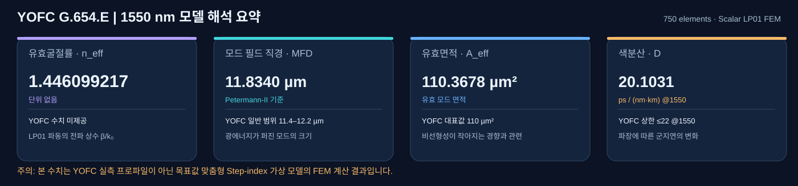

# COMSOL 검증 보고서 모음

## LS PremierLink LE125 G.654.E — 연구용 Step-index 근사 검증

- [G.654.E 실행 안내](./LS_PremierLinkLE125_G.654.E/README.md)
- [상세 검증 보고서](./LS_PremierLinkLE125_G.654.E/G654E_VALIDATION_REPORT.md)
- [Google Colab 실행 노트북](https://colab.research.google.com/github/kimheeseo/LSCNS/blob/main/COMSOL/validation_report/LS_PremierLinkLE125_G.654.E/G654E_Colab_Validation.ipynb)
- [수치 결과 ZIP](./LS_PremierLinkLE125_G.654.E/G654E_Colab_Results.zip)

**검증 범위:** MFD 12.5 µm를 참고해 이상적 Step-index 단면을 보정한 M7 관련 FEM·Bessel 계산입니다. 실제 제품의 내부 굴절률 구조나 독립 실측 데이터를 검증한 결과는 아닙니다.

## YOFC G.654.E — Step-index 근사 모델 검증 (2026-11-03)

- **[상세 검증 보고서 (Markdown)](./YOFC_G.654.E/VALIDATION_REPORT.md)** — 그림별 해석과 YOFC 공개 사양 비교.

**해석 범위:** 파장 1550 nm, Step-index 코어 반경 5.4 µm, Δn=0.004, 계산 영역 반경 40 µm, radial FEM 750 elements. MFD·Aeff는 공개된 대표값에 맞추어 입력을 조정한 것이므로 **실제 YOFC 제품의 독립 검증은 아닙니다.**

**핵심 결과:** n_eff 1.446099217, MFD_PII 11.8340 µm, Aeff 110.3678 µm², D1550 20.1031 ps/(nm·km), D slope 0.059088 ps/(nm²·km).
