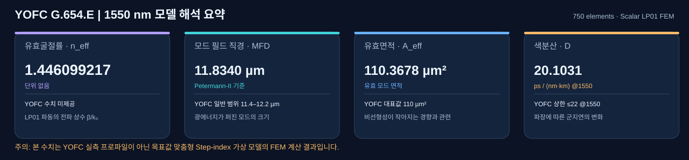
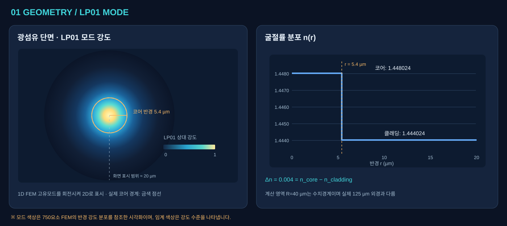
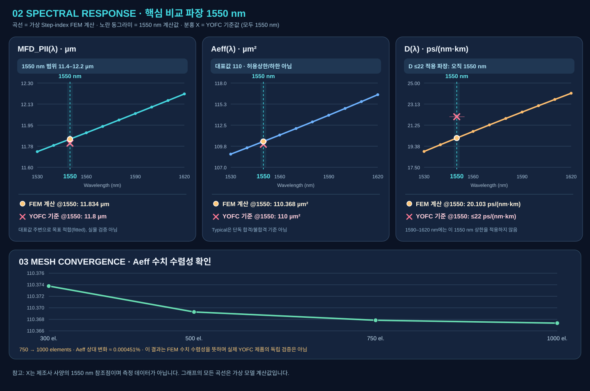

# YOFC G.654.E — 광섬유 단면·모드·굴절률 시각화 검증 보고서

> **검증일:** 2026-11-03  ·  **프로그램:** [LSCNS Universal Silica Fiber Lab](https://kimheeseo.github.io/LSCNS/COMSOL/universal_silica_v01/web/)  ·  **계산 방법:** Scalar LP₀₁ Radial P1 FEM (SciPy)  ·  **판정:** *사양값에 맞춘 근사 모델의 수치 검증, 실제 YOFC 제품 인증 아님*

이 보고서는 **그림 → 물리적 의미 → 시뮬레이션 값 → 제조사 비교** 순서로 읽도록 구성했습니다. YOFC에서 실제 굴절률 단면을 제공한 자료가 아니라 **MFD=11.8 µm, Aeff=110 µm²** 등의 성능 사양만 제공한 상태입니다. 따라서 **코어 반경 5.4 µm / Δn=0.004**는 제조사 설계값이 아니라 결과를 맞추기 위해 선택한 **Step-index 가상 모델의 입력값**입니다.

**바로가기:** [① 결과 대시보드](#1-한눈에-보는-1550-nm-결과) · [② 코어 단면과-모드](#2-광섬유-단면과-lp₀₁-모드-강도) · [③ 굴절률](#3-굴절률-프로파일-nr) · [④ 스펙트럼](#4-파장에-따른-mfd--aeff--색분산) · [⑤ 메시 검증](#5-fem-메시-수렴성) · [⑥ 한계](#6-무엇을-검증했고-무엇은-검증하지-않았나)

## 1. 한눈에 보는 1550 nm 결과

**사진 속 4개 카드의 의미**

| 출력 항목 | 물리적 의미 (쉽게 이해하기) | FEM 결과 | YOFC 사양과 비교 |
|---|---|---:|---|
| **유효굴절률 n_eff** | 광이 파이버 축을 따라 진행할 때의 전파상수 β를 굴절률처럼 표현한 값: n_eff=β/k₀ | **1.446099217** | 제품 사양표에 직접 비교 대상 없음 |
| **모드필드직경 MFD** | 코어 직경이 아닌 **빛의 전자기장이 코어 밖까지 퍼지는 유효 크기**; 여기서는 *Petermann-II* 정의 | **11.8340 µm** | YOFC 11.4–12.2 µm 안에 있음; 대표값 11.8 대비 +0.0340 µm (**+0.288%**) |
| **유효면적 Aeff** | 광 파워 분포를 반영한 비선형 효과 계산용 면적. 물리적 코어 면적과 다름 | **110.3678 µm²** | YOFC 대표값 110 대비 **+0.334%**. 단, 110은 명시된 허용 범위가 아니라 *Typical* |
| **색분산 D** | 파장 차이에 따른 군지연 차이가 거리당 얼마나 발생하는지 나타내는 값 | **20.1031 ps/(nm·km)** | YOFC **1550 nm에서 ≤22** 조건과 모델값 비교 시 범위 안 |

**주의:** 위 '범위 안'은 **가상 모델 결과가 제공된 수치 범위 안**이라는 의미입니다. MFD와 Aeff는 해당 목표값에 맞춰 조정했으므로, 오차가 작다는 사실이 YOFC 실물의 예측 정확도를 독립적으로 증명하지는 않습니다.

## 2. 광섬유 단면과 LP₀₁ 모드 강도

**왼쪽 그림 읽는 법**

- **중앙의 밝은 색**: LP₀₁ 기본 모드의 빛 세기가 큰 곳. 바깥으로 갈수록 강도가 약해집니다.
- **금색 점선 원**: 모델에서 지정한 **코어 경계 r=5.4 µm** (코어 직경=10.8 µm).
- **MFD=11.834 µm**: 빛의 분포를 나타내는 모드 직경입니다. **코어 직경 10.8 µm와 다릅니다.** 따라서 빛 일부가 클래딩 영역까지 확장되어도 이상하지 않습니다.
- 실제 계산은 원통대칭 구조의 **1차원 반경 방향 FEM**입니다. 그림은 해당 FEM 필드 강도의 반경 분포를 회전시켜 **2D로 시각화**한 것이지 COMSOL 2D 해석 결과가 아닙니다.
- 중앙 색은 정규화 모드 강도의 시각적 표현입니다. 컬러는 빛의 절대 파워(dBm)를 뜻하지 않습니다.

**왜 확인하는가?** 단일모드 광섬유 설계에서 빛의 퍼짐(MFD)을 결정하는 중요한 요인은 코어 반경과 굴절률 차입니다. MFD가 달라지면 Aeff나 접속 특성, 비선형성에도 영향을 줄 수 있습니다. 이 그림은 **광의 공간적 모양을 확인하는 그림**입니다.

## 3. 굴절률 프로파일 n(r)

위 그림의 **오른쪽 계단형 곡선**은 반경 r에 따른 굴절률입니다.

| 영역 | 반경 | 모델의 굴절률 @1550 nm | 해석 |
|---|---:|---:|---|
| 코어 | 0 ≤ r < 5.4 µm | **1.4480236** | 실리카 기준값 + 0.004 |
| 클래딩 | 5.4 ≤ r ≤ 계산 경계 | **1.4440236** | 순수 실리카 Sellmeier 기준값 |
| 차이 | — | **Δn = 0.0040000** | 빛을 코어 중심에 상대적으로 가두는 굴절률 차 |

이렇게 **계단처럼 점프**하는 이유는 계산 유형을 **Step-index**로 선택했기 때문입니다. YOFC 실제 제품이 동일한 Step-index 프로파일이라는 뜻은 아닙니다. 실제 상용 광섬유는 복합 도핑/굴절률 설계를 사용할 수 있습니다.

**계산 경계와 물리적 지름 구분:** 입력 화면의 `R=40 µm`는 FEM 계산 영역의 **반경**이고, 제조사 표의 클래딩 외경 `125±1 µm`는 광섬유의 **실제 물리 지름**입니다. 서로 같은 숫자를 입력해야 하는 항목이 아닙니다.

## 4. 파장에 따른 MFD / Aeff / 색분산

**윗줄 3개 그래프 읽는 법**

1. **왼쪽 — MFD(λ):** 이 근사 모델에서 파장이 1530→1620 nm로 길어지면 LP₀₁ 모드가 넓어져 MFD가 약 **11.730→12.209 µm**로 증가합니다.
2. **중앙 — Aeff(λ):** 모드가 넓어짐에 따라 Aeff도 약 **108.713→116.478 µm²**로 증가합니다. 이는 *해당 모델*의 예측입니다.
3. **오른쪽 — D(λ):** 1530 nm에서는 **18.908**, 1550 nm에서는 **20.103**, 1620 nm에서는 **24.091 ps/(nm·km)**로 증가합니다.

분산 기울기는 `[D(1560)-D(1540)] / (20 nm)`로 계산한 **0.059088 ps/(nm²·km)**입니다. YOFC의 1550 nm 분산 기울기 조건 **≤0.070 ps/(nm²·km)**와 모델 계산값을 비교할 수 있습니다.

**기준을 적용하는 파장에 유의:** YOFC 표의 **D ≤22**는 *1550 nm에서* 제시된 값입니다. 모델의 D(1590), D(1620)이 22를 넘는다고 해서 이 표만으로 부적합 판정을 할 수 없습니다. 분홍색 **× 표시**는 1550 nm의 제조사 대표값 또는 상한을 나타냅니다. 전 파장에 동일한 상한을 적용한 것이 아닙니다.

## 5. FEM 메시 수렴성

위 이미지 **아랫줄**은 Radial FEM 메시 수(Elements)를 변화시키면서 Aeff가 얼마나 달라지는지 보여 줍니다.

| 메시 수 | MFD_PII (µm) | Aeff (µm²) | D1550 (ps/(nm·km)) |
|---:|---:|---:|---:|
| 300 | 11.834270 | 110.373769 | 20.102564 |
| 500 | 11.834089 | 110.369281 | 20.102950 |
| **750** | **11.834031** | **110.367841** | **20.103068** |
| 1000 | 11.834011 | 110.367343 | 20.103109 |

**750→1000 요소일 때 Aeff 변화율 ≈ 0.000451%**입니다. 메쉬를 더 촘촘하게 나누어도 결과가 거의 변하지 않으므로 **이 가상 모델에 대한 수치해의 안정성**을 확인할 수 있습니다. 이것은 제조사의 실물 광섬유와 일치한다는 의미와는 다릅니다.

## 6. 무엇을 검증했고, 무엇은 검증하지 않았나?

| 구분 | 항목 | 상태 |
|---|---|---|
| **수치 계산 완료** | LP₀₁ 모드, n_eff, MFD(Petermann-II), Aeff, D(1550), 분산 기울기, 파장 스윕, 메시 수렴성 | 완료 — **Step-index 근사 모델에 한정** |
| **참고 수치에 맞춤** | MFD 대표값 11.8 µm, Aeff 대표값 110 µm² | 입력 조정에 사용 — **독립 검증 아님** |
| **현재 계산되지 않음** | 감쇠 @1550(≤0.174 dB/km), Cable cut-off (≤1530 nm), PMD (≤0.2 ps/√km), 굽힘 손실, 생산 편차, 125 µm 외경 허용오차 | 불가 — 별도 측정/물리 모델 필요 |
| **제품 수준 미검증** | YOFC 실제 굴절률 분포(RIP), 도핑 물성/파장 의존성, MFD 측정 방식, 상용케이블 구조 | 실측 자료가 없음 |
| **COMSOL Wave Optics** | 상용 COMSOL 실행 결과와 비교 | 수행하지 않음. 본 모델은 **Python/SciPy Radial FEM** |

### 입력값 → 계산 → 결과 해석의 흐름

`코어 반경 5.4 µm / Δn=0.004 / 파장 1550 nm` → 반경별 `n(r)` 생성 → 고유모드 및 `n_eff` 계산 → `LP₀₁ 강도 분포` 시각화 → `MFD / Aeff` 산출 → 파장별 `n_eff(λ)` 미분으로 `D(λ)` 계산 → YOFC 사양과 비교.

## 7. 재실행 및 원본 데이터

- **웹 시뮬레이터:** [Universal Silica Fiber Lab 실행](https://kimheeseo.github.io/LSCNS/COMSOL/universal_silica_v01/web/) — 설계유형 **Step-index**, 파장 **1550 nm**, 코어 반경 **5.4 µm**, 코어 Δn **0.004**, R **40 µm**, n₂(×10⁻²⁰) **2.2**, Mesh **750**.
- **노트북:** [YOFC_G.654.E_validation.ipynb](./YOFC_G.654.E_validation.ipynb) — FEM 계산, 모드 단면/굴절률 시각화, 파장별 특성, 메시 수렴.
- **원본 솔버:** [universal_radial.py](../../universal_silica_v01/universal_radial.py) — Scipy radial P1 FEM.
- **결과 데이터:** [comparison.csv](./comparison.csv) · [spectrum.csv](./spectrum.csv) · [mesh_convergence.csv](./mesh_convergence.csv) · [summary.json](./summary.json)
- **본 보고서의 도해:** [dashboard.svg](./assets/dashboard.svg) · [mode_index.svg](./assets/mode_index.svg) · [spectrum_mesh.svg](./assets/spectrum_mesh.svg)

### 종합 결론

**현재 단계는 “제조사가 제시한 MFD·Aeff 목표값과 맞는 가상 단면 모델을 구성하고, 그 모델이 안정적으로 계산되는지 확인한 단계”입니다.** 개별 그래프는 무엇을 계산하는지와 결과 해석을 돕지만, 실제 YOFC 광섬유의 물성이나 제조사 사양 인증을 대체하지는 않습니다. 실물 모델 검증을 위해서는 제조사/시험실의 **반경별 굴절률 프로파일, 여러 파장에서의 MFD 및 분산 실측치**가 필요합니다.
