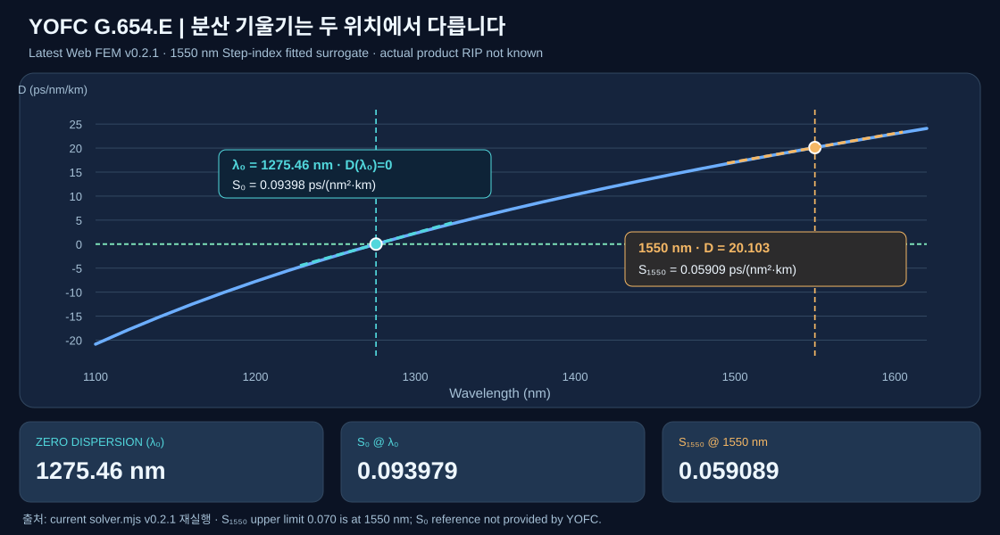

# YOFC G.654.E — 최신 웹 솔버 v0.2.1 재계산 검증 보고서

> **재계산 날짜:** 2026-11-03 · **해석 엔진:** [Universal Silica Fiber Lab](https://kimheeseo.github.io/LSCNS/COMSOL/universal_silica_v01/web/?v=20261103-slope-v1) · **solver.mjs SHA:** `a05fc21585d1d164bb95ef0db7abd97547acae9f` · **검증 수준:** 수치 모델 재현/사양 비교. **YOFC 실제 제품 인증은 아님.**

기존 `YOFC_G.654.E_validation.ipynb`의 Step-index 근사 모델을 **현재 웹 프로그램에서 실제 사용 중인 JavaScript radial P1 FEM**으로 다시 실행했습니다. 웹의 `solve()`, `dispersion()`, `dispersionDiagnostics()`, `spectrum()`, `meshStudy()`를 이용했습니다. 노트북에는 정확한 웹 솔버 소스를 포함해 Node.js로 재계산하는 셀을 추가했습니다.

**보고서 바로가기:** [HTML 대시보드](./VISUAL_REPORT.html) · [Jupyter Notebook](./YOFC_G.654.E_validation.ipynb) · [실제 웹 솔버 실행 기록](./web_solver_rerun.json)

## 1. 모델 입력과 비교 범위

| 항목 | 입력 조건 | 해석 |
|---|---:|---|
| 분포 유형 | `step` | 실제 YOFC RIP 미공개; 이상적 Step-index 근사 |
| 해석 파장 | 1550 nm | 기본모드 및 분산 비교 기준 |
| 코어 반경 | 5.4 µm | YOFC 공시값 아님, 목표 MFD·Aeff에 맞춘 가정 |
| 코어 Δn | 0.004 | 파장에 독립적인 실리카 기준 굴절률 오프셋 |
| FEM 계산 경계 R | 40 µm | 클래딩 실제 외경 125 µm와 별개 |
| 비선형 굴절률 n₂ | 2.2e-20 m²/W | 이전 G.654.E 유사 예제의 가정값 |
| Radial FEM Mesh | 750 elements | 약유도 LP₀₁ 스칼라 반경 FEM |

**중요:** 이번 계산은 YOFC의 실제 단면 프로파일을 역산해 특정한 것이 아닙니다. MFD 대표 11.8 µm와 Aeff 대표 110 µm²에 가까운 가상의 입력값을 선정한 모델이므로 **대표값 오차가 작다는 사실만으로 제품 예측의 정확도가 증명되지는 않습니다.**

## 2. 웹 솔버 재계산 결과 — 1550 nm

| 광학 항목 | 최신 Web v0.2.1 계산 | YOFC 자료 | 판정/의미 |
|---|---:|---:|---|
| 유효굴절률 n_eff | **1.446099217** | 미제공 | LP₀₁ 전파상수 β/k₀ |
| MFD (Petermann-II) | **11.8340 µm** | 11.4–12.2, typical 11.8 µm | 가정 모델의 값은 범위 내, 대표값 대비 **0.288%** |
| MFD (second-moment) | 12.0857 µm | 정의 미제공 | Petermann-II와 정의가 다름 |
| Aeff | **110.3678 µm²** | Typical 110 µm² | 대표값 대비 **0.334%**; 110은 허용오차 상한 아님 |
| 색분산 D @1550 | **20.1031 ps/(nm·km)** | ≤22 @1550 | 계산된 근사 모델은 해당 상한 안 |
| 고유값 잔차 | 1.002e-12 | 해당 없음 | 수치해법의 잔차, 제품 예측 오차가 아님 |

## 3. 광섬유 단면과 굴절률 분포

- **좌측 LP₀₁ 모드 강도**: 코어 반경 5.4 µm(지름 10.8 µm)의 경계 밖까지 빛의 세기가 퍼집니다. 따라서 MFD 11.834 µm와 실제 코어 직경은 다릅니다. 반경 방향 FEM을 2D로 회전한 **시각화**이며 COMSOL 2D/3D 해석이 아닙니다.
- **우측 n(r)**: 코어 굴절률은 순수 실리카보다 Δn=0.004 높다고 가정합니다. Step-index이므로 코어 경계에서 계단처럼 변합니다. **실제 YOFC 도핑·트렌치 구조를 확인한 것은 아닙니다.**

## 4. 파장별 MFD·Aeff·색분산 — 1550 nm 비교

세 파장별 패널에서 **1550 nm 위치의 노란 원은 FEM 계산값**, 분홍 X는 사용자가 제공한 **YOFC 1550 nm 사양 기준**입니다. X는 실제 측정점이 아닙니다. 표에 없는 다른 파장에서도 동일한 사양 상한을 적용해서는 안 됩니다.

- MFD(1530→1620): **11.730→12.209 µm**
- Aeff(1530→1620): **108.713→116.478 µm²**
- D(1530→1620): **18.908→24.091 ps/(nm·km)**

## 5. 새로 추가한 핵심 결과 — S₁₅₅₀, λ₀, S₀

| 분산 항목 | 최신 Web v0.2.1 계산값 | YOFC 표와의 대응 |
|---|---:|---|
| **S₁₅₅₀ = dD/dλ at 1550 nm** | **0.059089 ps/(nm²·km)** | **1550 nm 분산 기울기 상한 ≤0.070**과 비교 가능 |
| **λ₀ = D(λ₀)=0** | **1275.457 nm** | YOFC 제공 표에 수치 없음 |
| **S₀ = dD/dλ at λ₀** | **0.093979 ps/(nm²·km)** | YOFC 제공 표에 수치 없음. **S₁₅₅₀ 상한 적용 금지** |

**공식과 연산 규칙:**

\[
S_{1550} \approx \frac{D(1560)-D(1540)}{20\,\mathrm{nm}},\qquad
S_{0} \approx \frac{D(\lambda_0+10)-D(\lambda_0-10)}{20\,\mathrm{nm}}
\]

- 웹 코드는 **1100–1550 nm** 구간에서 `D(λ)` 부호 변화를 찾아 `λ₀`를 세분 탐색합니다. 만약 이 구간에 D=0 지점이 없으면 S₀는 **산출 불가**로 반환합니다.
- `D(λ)`는 동일 FEM에서 계산한 `n_eff(λ)`의 **5점 2차 차분**이며, 위 기울기의 D 함수는 내부 파장 차분 간격 **5 nm**, 기울기의 반폭 **10 nm**를 사용합니다. 1550 nm 기본 D 출력은 기존 UI 함수의 **10 nm 간격**을 유지하므로 미세한 수치 차이가 생길 수 있습니다.
- 이전 보고서에서 **`dispersion slope = 0.059088`**로 쓰인 값은 이제 명확히 **`S₁₅₅₀`**로 이름을 바꿨습니다. **`S₀`는 별도로 계산한 0.093979**입니다.
- YOFC 사양서에 기재된 **dispersion slope @1550 ≤0.070**은 *S₁₅₅₀*의 기준입니다. λ₀ 및 S₀에 대응되는 제조사 실측 기준은 제공되지 않았습니다.

## 6. 최신 JavaScript 웹 FEM의 메시 수렴성

기존 `mesh_convergence.csv`는 이전 **Python SciPy** 솔버 결과로 남기고, 이번 웹 솔버 결과는 [`web_mesh_convergence.csv`](./web_mesh_convergence.csv)로 별도 보관했습니다. 웹 솔버는 구간별 메시 배분 과정에서 **요청 300/500 요소를 실제 301/501 요소**로 산정할 수 있습니다.

| 요청 요소 | 웹 실제 요소 | MFD_PII (µm) | Aeff (µm²) | neff |
|---:|---:|---:|---:|---:|
| 300 | 301 | 11.834271 | 110.373822 | 1.446099072 |
| 500 | 501 | 11.834088 | 110.369268 | 1.446099183 |
| 750 | 750 | 11.834031 | 110.367841 | 1.446099217 |
| 1000 | 1000 | 11.834011 | 110.367343 | 1.446099230 |

**750→1000 요소의 Aeff 상대 변화:** **0.000451%**. 이것은 **근사 모델의 FEM 수치수렴**을 뜻하며 제조사 제품의 물성 검증을 의미하지 않습니다.

## 7. YOFC 사양 중 현 모델이 직접 검증하지 못하는 것

| 항목 | YOFC 표에 기재된 정보 | 현 모델 상태 |
|---|---|---|
| 감쇠 @1550 | ≤0.174 dB/km, typical 0.160 | 광학 손실 모델/실측 없이 **검증 불가** |
| Cut-off wavelength | ≤1530 nm, typical 1440 | 케이블 컷오프 직접 계산 불가 |
| PMD | ≤0.2 ps/√km | 편광 분리 및 불규칙 복굴절 미모델링 |
| Macro-bend loss | 1550 nm ≤0.1 dB (표 조건) | 굽힘에 따른 복소 전파상수 미계산 |
| 실제 RIP 및 도핑 분산 | 제공되지 않음 | 실물 검증에 필요한 핵심 입력 |

## 8. 산출물·재실행 방법

- **[YOFC_G.654.E_validation.ipynb](./YOFC_G.654.E_validation.ipynb)** — 기존 Python SciPy 모델의 표·그림을 유지하고, *현 Web v0.2.1 JavaScript 코드 자체를 내장*하여 Node.js ≥18에서 정확한 FEM 재계산 및 대조가 가능하도록 확장.
- **[VISUAL_REPORT.html](./VISUAL_REPORT.html)** — 모바일·PC 반응형 그림과 함께 S₁₅₅₀/λ₀/S₀를 별도 해설.
- **[web_solver_rerun.json](./web_solver_rerun.json)** — 웹 솔버로 새로 실행한 값, 코드 SHA 및 사용 입력과 D(λ) 스윕.
- **[comparison.csv](./comparison.csv)** — YOFC 사양 vs Web v0.2.1 비교.
- **[spectrum.csv](./spectrum.csv)** — 최신 Web v0.2.1 1530–1620 nm 스윕.
- **[dispersion_curve_web.csv](./dispersion_curve_web.csv)** — 1100–1620 nm D(λ) 곡선과 λ₀.
- **[web_mesh_convergence.csv](./web_mesh_convergence.csv)** — 요청/실제 요소와 수치 수렴.
- **[mesh_convergence.csv](./mesh_convergence.csv)** — 이전 Python SciPy 수렴 데이터(비교 보존).
- **[summary.json](./summary.json)** — 최신 결과 요약 및 분산 미분 정의.

### 최종 해석

현재 YOFC 근사 모델에서 **MFD=11.8340 µm, Aeff=110.3678 µm², D1550=20.1031 ps/(nm·km), S1550=0.059089 ps/(nm²·km)**입니다. 각각 제시된 대표값 또는 상한과 비교할 수 있지만, 모델 입력을 맞췄다는 점 때문에 **실제 YOFC 제품의 독립 검증으로 해석할 수 없습니다.** 새로운 **λ₀=1275.457 nm와 S₀=0.093979 ps/(nm²·km)**는 **가상 모델에서 추가 예측한 값**이며 사양서에 대응하는 제품 참조값이 없습니다.

**재현성:** GitHub에 저장된 `web_solver_rerun.json`은 현재 `solver.mjs`의 실행값입니다. 새로고침 뒤 사용자가 모델 파라미터를 다르게 변경하면 웹 화면 결과는 달라집니다. 소스가 갱신되었을 때도 노트북에 임베딩된 `solver.mjs` SHA와 비교해야 합니다.
