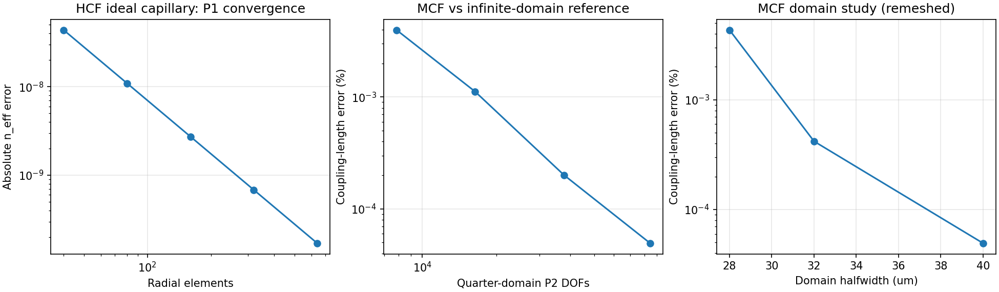

# M8 — HCF / 2코어 MCF 검증 개선 보고서

검증 판정 **22/22 통과**. 테스트 결과는 [tests.xml](validation/results/tests.xml), [원시 판정표](validation/results/checks.csv)를 확인하십시오. 테스트 통과 개수는 물리적 오차율이 아닙니다.

| 대상 | 비교 기준 | 기본 조건의 오차 |
|---|---|---:|
| HCF 모세관 neff | 이상적 모세관 Bessel 해 | 절대 1.70787e-10, 상대 1.70874e-08% |
| HCF 모세관 D | 이상적 모세관 해석 미분 | 2.18772e-05% |
| 2코어 MCF Δneff | 무한영역 원통함수 경계 정합 | 4.92814e-05% |
| 2코어 MCF Lc | 무한영역 원통함수 경계 정합 | 4.92814e-05% |

오차율은 `100×|계산값−기준값|/|기준값|`이며, 유효굴절률 절대 오차는 `|Δneff|`입니다. **실제 제품·COMSOL·실측 데이터 대비 오차율은 아직 산정하지 않았습니다.** 오차율이 작아도 모델의 생략된 물리가 검증되는 것은 아닙니다.

- [HCF 상세 보고서](HCF_VALIDATION_REPORT.md)
- [2코어 MCF 상세 보고서](MCF_2CORE_VALIDATION_REPORT.md)
- [Colab: 실행 결과 포함](https://colab.research.google.com/github/kimheeseo/LSCNS/blob/main/COMSOL/waveoptics_m8/M8_HCF_MCF_2Core_Validation.ipynb)
- [입력·실행 방법](README.md)

기존 `screenshots/`와 Cartesian `solve_two_core`는 과거 결과·호환용으로 유지합니다. 현재 검증 결과는 `validation/results/`이며 서로 다른 결과를 섞어 해석하지 마십시오.
