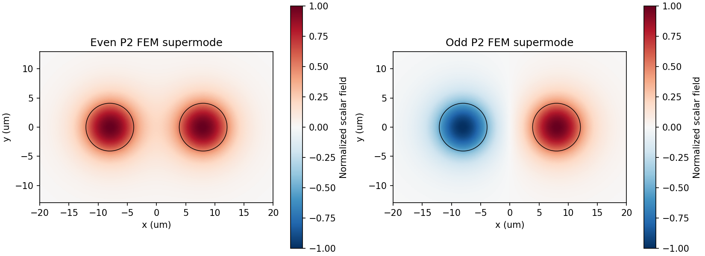
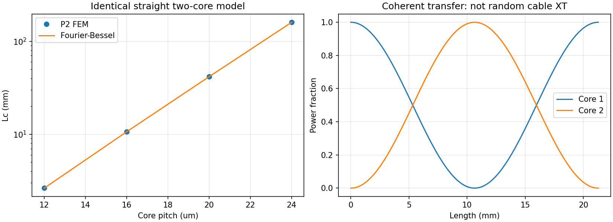

# 2코어 MCF 검증 보고서 — M8 개선

**동일한 원형 스텝형 코어 2개, 직선·무손실·약도파 스칼라 모델**의 짝/홀 슈퍼모드와 결합 길이를 검증했습니다.

오차율은 `100×|계산값−기준값|/|기준값|`이며, 유효굴절률 절대 오차는 `|Δneff|`입니다. **실제 제품·COMSOL·실측 데이터 대비 오차율은 아직 산정하지 않았습니다.** 오차율이 작아도 모델의 생략된 물리가 검증되는 것은 아닙니다.

## 입력과 기본 결과

| 입력 | 값 |
|---|---:|
| 파장 | 1.55 µm |
| 코어 반경 | 4.1 µm |
| 코어−클래딩 Δn | 0.005 |
| 코어 중심 간 거리 | 16.0 µm |
| 클래딩 굴절률 | 실리카 Sellmeier |
| 최종 영역 | −40.0…+40.0 µm 정사각형 |
| 최종 목표 메시 크기 | 0.3 µm |
| 1/4 영역 요소 / P2 자유도 | 41940 / 84417 |

| 출력 | 독립 무한영역 기준 | 개선 FEM | 상대 오차 % |
|---|---:|---:|---:|
| 짝모드 neff | 1.4461404299588 | 1.4461404293296 | 4.35149e-08 |
| 홀모드 neff | 1.4460675903559 | 1.4460675896908 | 4.59994e-08 |
| Δneff | 7.28396028979e-05 | 7.28396387943e-05 | 4.92814e-05 |
| 결합 길이 Lc (mm) | 10.6398163796 | 10.6398111362 | 4.92814e-05 |

짝/홀 neff의 최대 절대 오차는 6.65183e-10입니다. neff 자체 오차가 작아도 두 값의 차이인 Δneff는 상대 오차가 커질 수 있으므로 Δneff와 Lc를 직접 판정합니다.

## 개선 사항과 독립 기준

기존 M7 기반 Cartesian P1은 요소 중심으로 원형 코어 재료를 분류했습니다. 메시가 바뀔 때 경계 모양도 달라져 결과가 비단조적으로 변합니다.
개선 모델은 Gmsh의 원호 경계, 원 위에 놓인 P2 중간 노드, 곡선 기하 매핑, 코어/클래딩별 재료를 사용합니다. 원은 유한 차수 기하로 근사하므로 여전히 메시 검증이 필요합니다.

1/4 영역에서 y=0은 Neumann 대칭 조건입니다. x=0은 짝모드 Neumann, 홀모드 Dirichlet입니다. 외곽 x=L, y=L은 Dirichlet입니다. 동일 메시에서 두 대칭 문제를 풀어 메시 비대칭에 의한 인공 분리를 피합니다.

독립 기준은 유한영역이나 FEM을 사용하지 않습니다. 각 코어 내부 `J_m(qr)cos(mθ)`, 외부 `K_m(wr)cos(mθ)`를 전개하고 원형 경계에서 장과 법선 미분을 정합합니다. x 반사 대칭은 `b_right,m=±(−1)^m b_left,m`입니다. 무한 클래딩에서 감쇠하는 해를 직접 사용하며 차수·각도 샘플 수·분리 코어 극한을 검사했습니다.

| 원통함수 차수 | Δneff | Lc mm |
| --- | --- | --- |
| 2 | 7.283976825e-05 | 10.63979223 |
| 4 | 7.283960326e-05 | 10.63981633 |
| 6 | 7.28396029e-05 | 10.63981638 |
| 8 | 7.28396029e-05 | 10.63981638 |

본 보고서의 경계 정합 기준은 동일 스칼라 방정식에 대한 독립 수치 해입니다. 유한 차수 오차는 남아 있으며, 차수 수렴 검사를 통해 작음을 확인했습니다.

## 메시 수렴: 영역 고정

| 목표 h µm | 1/4 자유도 | 짝 neff 절대 오차 | Δneff 오차 % | Lc 오차 % |
| --- | --- | --- | --- | --- |
| 1 | 7856 | 5.561665151e-08 | 0.003977513947 | 0.003977355748 |
| 0.7 | 16373 | 1.444676578e-08 | 0.001120946659 | 0.001120934094 |
| 0.45 | 37736 | 2.851990866e-09 | 0.0001999698766 | 0.0001999694767 |
| 0.3 | 84417 | 6.292866228e-10 | 4.92814287e-05 | 4.928140442e-05 |

## 영역 수렴: 목표 h 고정

| 영역 반폭 µm | 1/4 자유도 | Lc mm | Lc 오차 % |
| --- | --- | --- | --- |
| 28 | 41721 | 10.63935623 | 0.004324772208 |
| 32 | 54312 | 10.63977185 | 0.0004185064458 |
| 40 | 84417 | 10.63981114 | 4.928140442e-05 |

영역별로 재메시하므로 이 표는 잔여 메시 오차도 포함합니다. 도메인 변화와 메시 세분화를 별도로 검사해야 합니다.

## 중심 간격별 검증

| 간격 µm | 기준 Lc mm | FEM Lc mm | Lc 오차 % |
| --- | --- | --- | --- |
| 12 | 2.63194966 | 2.631949064 | 2.264675818e-05 |
| 16 | 10.63981638 | 10.63981114 | 4.928140442e-05 |
| 20 | 41.6837316 | 41.68369781 | 8.106029982e-05 |
| 24 | 160.1305235 | 160.130319 | 0.000127744943 |

## 기존 P1과 비교

| 기존 grid | 기존 Lc mm | Δneff 오차 % | Lc 오차 % |
| --- | --- | --- | --- |
| 81 | 10.86098647 | 2.036372032 | 2.078702141 |
| 101 | 10.43377915 | 1.974713308 | 1.936473508 |
| 121 | 10.70258985 | 0.5865259631 | 0.5899863864 |

기존 P1의 영역 반폭은 27 µm입니다. 개선 비교는 메시·기하 차수·재료 경계·대칭 처리·영역 크기를 함께 바꾼 전체 변경 결과입니다. 개선 폭을 메시 차수 하나의 효과라고 단정하지 않습니다.

## 전력 전달과 사용 범위

`κ=πΔneff/λ`, `Lc=λ/(2Δneff)=π/(2κ)`이며, 길이 단위 변환 후 `P2(z)=sin²(πz/(2Lc))`, `P1=1−P2`입니다.
여기서 Lc는 처음으로 전력이 완전히 전달되는 길이입니다. 전체 비팅 주기는 2Lc입니다.

이 전력식은 동일 코어의 두 슈퍼모드를 사용한 코어 국소 상태 모델입니다. 실제 입력장 중첩·고차모드·방사모드까지 계산한 launch 효율은 아닙니다.
굽힘, 비틀림, 제조 불균일, 편광 결합과 길이별 랜덤 결합을 포함하지 않으므로 상용 MCF의 케이블 XT(dB/km)로 사용하면 안 됩니다.
독립 기준은 단일 코어 V<2.405, 동일 반경·동일 Δn, 서로 겹치지 않는 두 코어에 제한됩니다. 새로운 조건은 메시·영역·기준 차수 수렴을 다시 검사해야 합니다.

## 이론 자료

- Marcatili & Schmeltzer (1964), *Hollow Metallic and Dielectric Waveguides for Long Distance Optical Transmission and Lasers*, DOI [10.1002/j.1538-7305.1964.tb04108.x](https://doi.org/10.1002/j.1538-7305.1964.tb04108.x), [Bell Labs 공개 설명](https://www.nokia.com/bell-labs/publications-and-media/publications/hollow-metallic-and-dielectric-waveguides-for-long-distance-optical-transmission-and-lasers/).
- White et al. (2002), *Multipole method for microstructured optical fibers. I. Formulation*, DOI [10.1364/JOSAB.19.002322](https://doi.org/10.1364/JOSAB.19.002322). 원통 조화함수로 경계를 정합하는 방법 계열의 참고문헌입니다. 이번 독립 기준 코드는 직접 유도한 **스칼라 2원 경계 정합**이며, 논문의 전체 벡터 솔버나 논문 표를 재현했다고 주장하지 않습니다.

확인일: 2026-10-20 한국시간. 문헌의 일반적 방법과 이번 구현·검증 범위를 구분했습니다.
