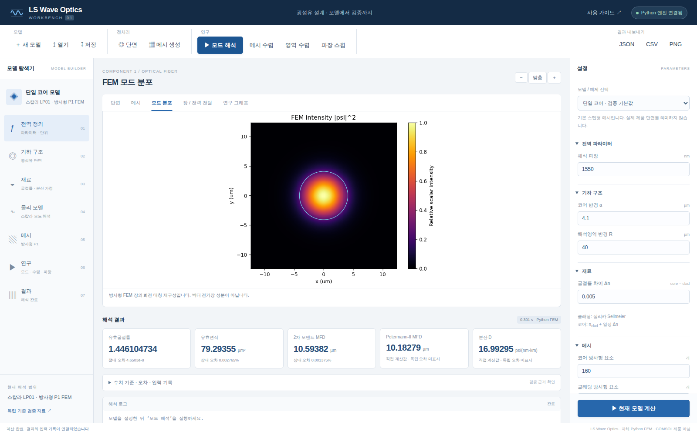
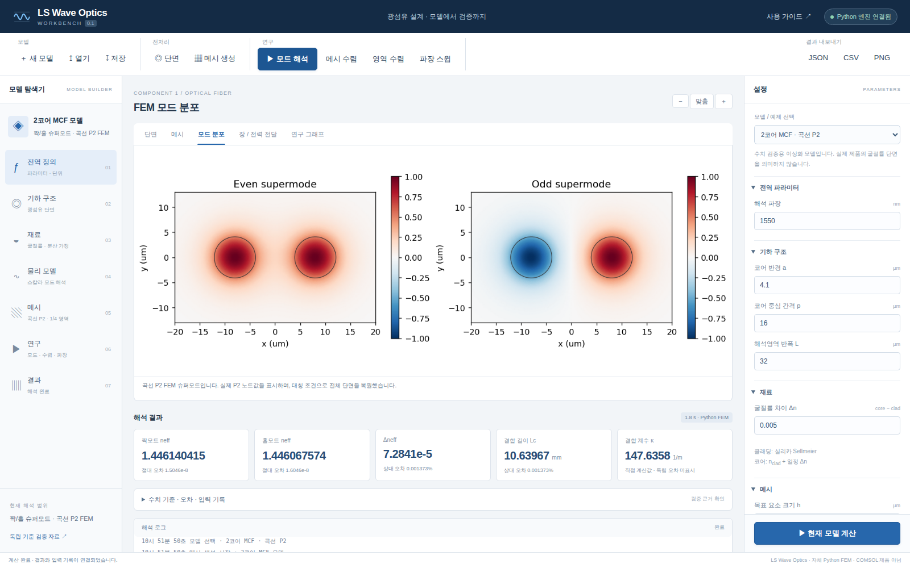

# Workbench v0.1 최종 검증

2026-10-20: **Linux·Windows 각각 Python 수치/HTTP 테스트 15개, Chromium 브라우저 통합 동작 10개 통과**. JavaScript 예외는 0건입니다.

- [최종 CI 실행: 성공](https://github.com/kimheeseo/LSCNS/actions/runs/39410790642)
- [기계 판독 가능한 검증 기록](evidence/final_ci.json)
- [Windows 결과](evidence/windows_tests.xml) · [Linux 결과](evidence/linux_tests_final.xml) · [브라우저 결과](evidence/browser_qa_final.json)
- [회사 PC용 소스 ZIP](https://github.com/kimheeseo/LSCNS/raw/refs/heads/main/COMSOL/workbench/LS_WaveOptics_Workbench_v0.1.zip) · [사용법](README.md)

Windows 검사는 배포하는 전용 소스 ZIP과 바이트 단위로 동일한 파일을 풀어 수행했습니다. 저장소의 다른 폴더를 Windows에서 체크아웃하는 과정 없이, 필요한 M7/M8 코드와 UI만으로 계산합니다. 배포 ZIP은 검증한 파일 그대로 유지했습니다. 이 문서와 아래 최종 화면은 검증 후 추가한 기록입니다.

ZIP SHA256: `9b377497a0626efb3cc62b5f72086f27a0975eef184d57c876167233b966f363`

## 실제 Python 계산 화면

## 검증 범위

단일 코어/HCF/MCF 수치 계산, 실제 메시, 입력 변경 재계산, 모델 저장·불러오기, CSV 다운로드, 수렴·파장 스윕, 정적 미리보기와 모바일 배치를 검사했습니다.

Windows Python 엔진과 HTTP 작업 프로세스를 검사했으며, Windows에서 배치 파일을 두 번 클릭해 브라우저를 여는 수동 GUI 과정은 별도 확인이 필요합니다.

**COMSOL 자체와의 수치 교차 검증은 수행하지 않았습니다.** 현재는 원형 단일 코어·동일 2코어·이상적 HCF 모세관의 스칼라 모델입니다. 벡터 Maxwell·PML·포트·임의 CAD·실제 ARF/NANF 손실·랜덤 케이블 누화는 구현 범위 밖입니다.
