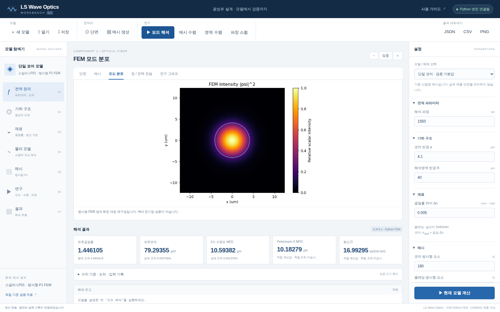
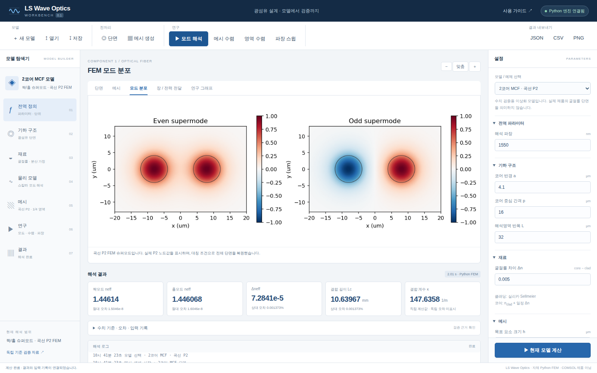

# Workbench v0.1 검증 보고서

## 무엇을 개선했는가

모델 탐색기·설정·단면·실제 메시·수치 해석·결과·오차를 하나의 UI로 연결했습니다. 기존 M7/M8 해석 엔진을 호출하며 UI가 수치를 보간해 계산한 것처럼 표시하지 않습니다.

## 검증 근거

- [첫 브라우저·수치 통합 CI: 통과](https://github.com/kimheeseo/LSCNS/actions/runs/39409596828)
- [최신 자동 검증 실행 목록](https://github.com/kimheeseo/LSCNS/actions/workflows/waveoptics-workbench.yml)
- [실제 브라우저 검사 기록](evidence/browser_qa.json): 10개 통합 동작, JavaScript 예외 0건.
- [수치 및 HTTP 테스트](evidence/tests.xml): 기본 14개 및 추가 FEM Petermann-II 독립 적분 검사 1개.
- [단일 코어 기본 실행 원본](sample_result.json), [HCF 점검](evidence/hcf_smoke.json), [MCF 점검](evidence/mcf_smoke.json).

첫 브라우저 검사는 Ubuntu·Python 3.12·Chromium의 실제 localhost Python 서버에서 수행했습니다. 이 실행은 neff 표시 정밀도를 높이기 전 화면이며, 기본 엔진과 수치 결과는 같습니다. 최신 CI는 Windows에서도 수치 해석과 HTTP 작업 프로세스를 재검증합니다. Windows에서 배치 파일을 두 번 클릭하는 GUI 과정 자체는 자동 검사하지 않습니다.

현재 대화 환경에서는 관리형 미리보기 브라우저가 제공되지 않아, 로컬 브라우저를 임의 설치·실행하지 않았습니다. 대신 GitHub Actions의 Chromium에서 실제 UI를 실행하고 저장된 화면을 내려받아 시각적으로 확인했습니다.

## 브라우저에서 확인한 동작

1. Python 엔진 연결과 입력값에 따른 단면.
2. 실제 단일 코어 FEM 실행·독립 기준 오차·장 이미지.
3. 입력 변경 시 이전 그래프 숨김 및 결과 내보내기 비활성화.
4. 모델 JSON 저장·다시 불러오기.
5. 실제 곡선 P2 메시 생성·2코어 슈퍼모드 해석.
6. HCF 반경 변경 시 분산 재계산, 잘못된 HCF 영역 수렴 차단.
7. HCF 메시 수렴 결과의 오차 감소.
8. 파장별 새 계산.
9. 정적 화면에서 저장 결과 표시·계산 버튼 비활성화·입력 변경 구분.
10. 390 px 모바일 화면에서 페이지 가로 넘침 없음.

## 기본 설정의 수치 점검

| 모델 및 설정 | 결과 | 독립 기준 대비 차이 |
|---|---:|---:|
| 단일 코어: 1550 nm, a=4.1 µm, Δn=0.005, R=40 µm, 160+640 요소 | neff=1.446104734078 | 절대 4.65e-8 |
| 같은 단일 코어 | Aeff=79.29355 µm² | 상대 약 0.002765% |
| HCF: R=15 µm, n=1.00027, 320 요소 | D=3.373170216 ps/(nm·km) | 상대 약 0.0000875% |
| MCF 점검: p=16 µm, a=4.1 µm, Δn=0.005, L=28 µm, h=0.7 µm | Lc=10.63925921 mm | 상대 약 0.005237% |

MCF UI 기본 영역 반폭은 32 µm입니다. 위 28 µm 점검과 구분하십시오. UI 기본값은 빠른 탐색용이며, M8의 최종 정밀 검증 조건(h=0.3 µm, L=40 µm)과 다릅니다. 입력을 바꾸면 오차도 달라지므로 현재 결과의 독립 기준 오차와 메시·영역 수렴을 확인해야 합니다.

## 실제 화면

## 검증의 한계

- UI/HTTP 동작 및 기존 스칼라 모델의 재현 검증입니다.
- COMSOL 라이선스로 실행한 결과와 직접 비교하지 않았습니다.
- 임의 CAD 형상·벡터 Maxwell·포트·PML·실제 ARF/NANF 손실·랜덤 MCF 누화는 미구현입니다.
- 예제 제품의 실제 굴절률 단면을 복원한 검증이 아닙니다.
- UI의 오차율을 실제 제품 정확도로 사용하면 안 됩니다.
