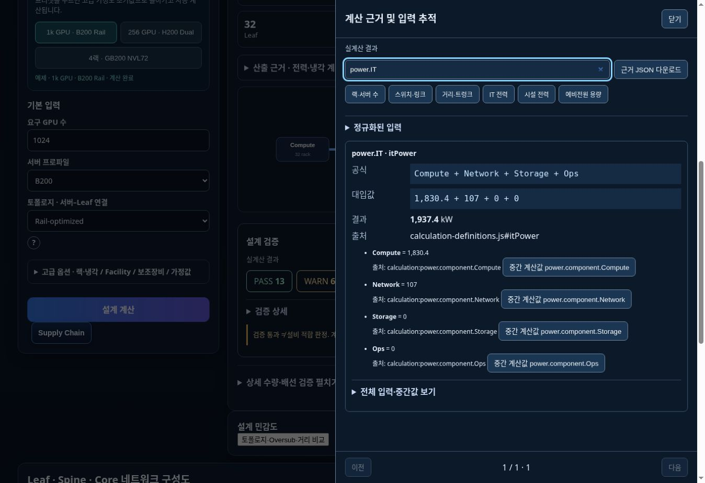

# DC BOM v8.2.0 계산 근거·설계 검증 변경 보고

작성일: 2026-11-18 KST. 대상: `DCI/DataCenter/`의 Engineering BOM 계산 경로.

## 사용 방법

1. 요구조건을 입력하고 **설계 계산**을 실행합니다.
2. 결과 영역의 **설계 검증** 카드에서 PASS/WARN/FAIL 수를 확인합니다. **검증 상세**를 펼치면 사유, 대입값, 수정 제안과 관련 근거를 볼 수 있습니다.
3. **계산 근거 보기**를 누르면 데스크톱은 오른쪽 패널, 모바일은 하단 패널이 열립니다. 항목별 공식, 대입값, 결과·단위, 입력 및 가정 출처가 표시됩니다.
4. 전력·랙·스위치·거리·전원 바로가기와 검색, 중간값 참조 버튼으로 계산 경로를 따라갈 수 있습니다. 배열은 요약 표시하며 **전체 입력·중간값 보기**에서 전체 값을 확인합니다. JSON 내보내기에는 정규화 전후 입력과 모든 중간값, 검증 결과가 포함됩니다.
5. 고급 옵션 → Design assumptions에서 UPS 보호 범위와 UPS/발전기/변압기 설치 수량을 지정할 수 있습니다. 설치 수량 0은 자동 산정이며 양수는 해당 설치 수량의 충분성을 검증합니다.

저장된 예시는 주황 점선으로 구분합니다. 실계산, 입력 변경으로 오래된 결과, 계산 중, 근거 없는 외부 결과를 구분하며 오래된 근거의 열기·내보내기는 막습니다.

## 공통 계산 정의와 출처

- `calculation-definitions.js`: 실행 가능한 공식의 공통 레지스트리. 엔진이 공식을 실행하면서 같은 정의의 식과 입력값을 기록하고, 화면은 기록을 읽습니다. 기존 첫 화면의 별도 공식 사본은 공통 패널을 열도록 교체했습니다.
- `engineering-v82.js`: 프로젝트 입력을 정규화하고 서버·랙·포트/경로·광배선·전력 산출을 실행합니다. 입력 필드, 중간값 ID, 모델 가정 출처를 기록합니다. OEM 프로파일 전력·RU·NIC 수는 가정 배지로 표시합니다.
- `design-validation.js`: DOM 없는 규칙 모듈. 각 규칙은 상태, 사유 키, 수정 제안 키, 대입값, 계산 근거 참조를 반환합니다.
- `design-validation-config.js`: 공랭 30 kW/랙, RDHx 50 kW/랙, Spare 최소 5%, oversubscription 경고 2:1, 광 마진 최소 0.2 dB, 최소 radix 4, 길이 반올림 목록 및 수치 허용오차를 정의합니다. 이 값은 계획 기준이며 프로젝트에서 수정할 수 있습니다. 공랭/RDHx 기준은 입력 화면에서도 조정 가능합니다.
- `calculation-evidence-ui.js` / `.css` / `-i18n.js`: 표시, 접근 가능한 dialog, 모바일 bottom sheet, 한/일/영/중/독 새 문구를 담당합니다.
- `index.html`, `engineering-preview.html`, `customer-designer.html`, `sw.js`: 동일 버전 의존성 및 캐시 갱신을 반영했습니다.

## 용량·예비율 해석

- IT 전력은 실제 설치 랙의 Compute + Network + Storage + Ops 부하 합계입니다. 구매 예비품은 설치 전력에서 제외합니다. 시설전력은 IT × PUE입니다.
- Leaf/Spine/Core 수는 독립 Fabric 도메인과 실제 포트 그래프에서 계산합니다. 2-tier Spine 집선과 3-tier pod/core plane의 정수 포트 배분도 기록합니다. 라우트별 링크 합계와 스위치 실제 사용 포트를 검사합니다.
- 케이블 길이는 `(경로 + 수직 상승 + 양단 종단 여유) × slack` 뒤 발주 표준 길이로 올림한 값입니다. 도달거리 검사는 발주 길이를 사용합니다.
- 트렁크는 각 독립 경로마다 `ceil(링크 / 트렁크당 채널)`을 적용한 뒤 합칩니다. 서로 다른 경로의 잔여 심수를 합쳐 수량을 줄이지 않습니다.
- 예비품은 `ceil(설치 × Spare %)`이며, 발주 수량은 `(설치 + 예비)`를 구매 묶음 단위로 올림합니다. 광배선 결과와 BOM에서 trunkBundle 적용 수량이 일치하도록 수정했습니다.
- UPS 기본 보호 범위는 기존처럼 IT 부하입니다. 전체 시설 부하도 선택할 수 있습니다. UPS kVA를 시설 kW와 직접 비교하지 않습니다. 보호 부하/PF/UPS 효율에 시설 여유율을 반영합니다.
- 발전기는 시설전력, 변압기는 시설전력/PF에 여유율을 적용합니다. 모듈 유효 용량은 정격 × 이용률입니다. 운전 필요 N은 `ceil(설계 용량 / 모듈 유효 용량)`입니다.
- 자동 설치는 N: N, N+1: N+1, 2N: 2×N입니다. 검증 시 가용 모듈 수를 각각 설치 수, 설치 수−1, floor(설치 수/2)로 계산합니다. 2N의 독립 전원 경로·배전·배터리 지속시간은 별도 검토 대상입니다.

## 대표 시나리오 결과

공통: 48 RU, 예약 4 RU, 랙 여유 20%, 64-port radix, oversubscription 1:1, PUE 1.2, Spare 10%, Facility 포함, N+1, 광 마진 0.2 dB. 서버 전력과 포트는 기존 계획 프로파일을 유지했습니다. 별도 지정하지 않은 입력은 엔진 기본값입니다.

| 항목 | H200 | B200 | B300 |
|---|---:|---:|---:|
| GPU 수 | 256 | 1,024 | 4,096 |
| 토폴로지 | Dual ToR | Rail | 3-tier Clos |
| 냉각 방식 | Air | DLC | DLC |
| 랙 전력/냉각 한도 kW | 30 / 30 | 100 / 100 | 100 / 100 |
| 서버 수 | 32 | 128 | 512 |
| Compute 랙 / 전체 랙 | 16 / 22 | 32 / 37 | 128 / 150 |
| Leaf / Spine / Core | 32 / 16 / 0 | 32 / 16 / 0 | 128 / 128 / 128 |
| 서버–Leaf 링크 | 256 | 1,024 | 4,096 |
| Leaf–Spine 링크 | 1,024 | 1,024 | 4,096 |
| Spine–Core 링크 | 0 | 0 | 4,096 |
| IT 전력 kW | 426.9 | 1,937.4 | 8,495 |
| 시설전력 kW | 512.28 | 2,324.88 | 10,194 |
| UPS / 발전기 / 변압기 모듈 | 2 / 2 / 2 | 5 / 3 / 3 | 16 / 8 / 7 |
| PASS / WARN / FAIL | 16 / 3 / 0 | 16 / 3 / 0 | 19 / 4 / 0 |

세 시나리오 모두 산술 회귀 및 포트/링크 보존 검사를 통과했습니다. 검증의 전체 상태는 **WARN**입니다. 양 끝 광모듈 SKU가 미확정인 각 광 링크와 일반 계획 가정에 대한 검토가 남아 있기 때문입니다. 기본 첫 화면은 Air, Facility 미포함, 광 마진 0이므로 위 테스트와 WARN 수가 다릅니다.

## 테스트와 관찰

실행:

```sh
node --test DCI/DataCenter/tests/calculation-validation.test.cjs DCI/DataCenter/tests/engineering-v82.test.cjs DCI/DataCenter/design-checks.test.cjs
```

- 새 테스트 29개 통과, 기존 엔진 독립 검사 25개와 기존 제약 검사 6개 통과. 기존 파일은 자체 25개 검사를 수행하는 단일 Node test 파일이므로 Node 요약에는 총 36개 항목으로 표시됩니다.
- 세 시나리오의 알려진 산출값 비교, 모든 기록 공식의 재실행 일치, 중간값 참조 존재 여부, BOM 수량 근거 일치, 한/일/영/중/독 키 완전성을 검사했습니다.
- N/N+1/2N 자동 수량 및 각 설비 설치 1개 부족, UPS 보호 범위 변경, Facility 미포함, 잘못된 redundancy, 냉각·전력 초과, radix 부족, 4:1 oversubscription, 2→3-tier 자동 승격을 검사했습니다.
- DAC 400/800G, AOC, SR, DR, FR의 도달거리 경계와 표준 길이 올림 후 초과, 명시 SKU의 거리 제한, 광 손실 예산 초과를 검사했습니다.
- 작은 트렁크 요청이 자동 보정돼도 FAIL이 유지되는지, 불완전 채널 정합 WARN, 경로별 96F 트렁크 수량, 8개 묶음 발주, Spare 임계값 변경, 스토리지 부하, 잘못된 분모 입력 보정, NVL72 및 MW 입력, 세 브라우저 진입점의 공통 계산 모듈 선행 로딩을 검사했습니다.
- 브라우저에서 데스크톱 우측 패널, 계산 근거 검색 및 중간값 링크, 5개 언어 전환, 설치 UPS 1개 입력 시 FAIL, 입력 변경 시 오래된 결과 표시, JSON 다운로드 후 파싱, 닫기 시 초점 복귀를 확인했습니다.
- 390px iframe의 모바일 뷰포트에서 패널이 하단 86dvh로 열리고 긴 식이 줄바꿈되는 것을 확인했습니다. 실제 모바일 기기 시험은 수행하지 않았습니다.

**검증 통과 ≠ 설비 적합 판정.** 본 기능은 입력한 계획 가정에 대한 산술·규칙 검증입니다. 실제 제조사 SKU 호환성, FEC, 열·전기 설계, 시공·인증 조건을 대체하지 않습니다. 별도 용량 API가 산출한 근거 없는 결과를 Engineering 계산 결과로 표시하지 않습니다.

## 데스크톱 검토 화면


