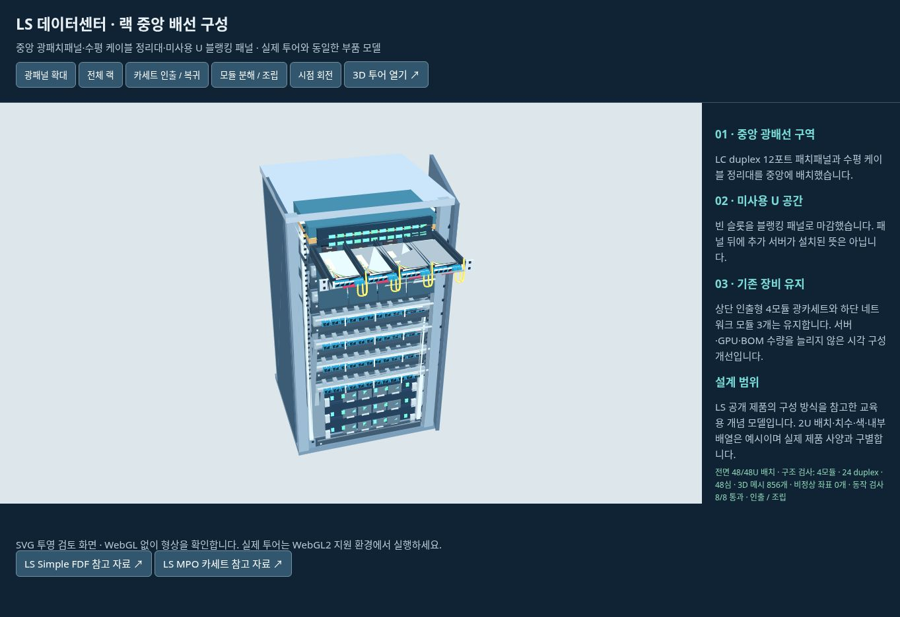

# 랙 중앙 빈 공간 개선 · 2026-10-24

네트워크 랙은 기존 하단 모듈 3개와 상단 ToR·광카세트만 표시되어 중앙 U 공간이 비어 보였습니다.

- 네트워크/ODF 랙 중앙의 미사용 U에 2U 광패치패널과 1U 수평 케이블 정리대를 배치했습니다.
- 남는 U는 1~3U 블랭킹 패널로 마감하고 예비 공간임을 설명합니다.
- GPU·일반 서버·스토리지 랙의 미사용 U에도 블랭킹 패널을 적용했습니다.
- 새 부품을 클릭하거나 3D 설비 검사의 부품 목록에서 선택하면 이름과 용도를 확인합니다.
- 패치패널은 패널당 LC duplex 12개를 표시한 교육용 예시입니다. 실제 광심수·서버/GPU 수량·BOM 엔진은 변경하지 않습니다.
- 반복되는 LC 포트와 정리대 핑거는 InstancedMesh로 묶어 렌더링 부담을 줄입니다.

## 검증

네트워크·ODF·GPU·스토리지·일반 서버 5개 랙 구성에서 전면 U 위치가 빠짐없이 배정되고,
활성 모듈 수가 유지되는지 검사했습니다. 중복·범위 초과 U 배치를 거부하는 검사를 포함해 단위검사 6개가 통과했습니다.
동일 부품 모델의 SVG 검토 화면에서 중앙 패널·LC 포트·마감 패널 형상을 확인했습니다.

[구조 검토 화면](rack-fill-review.html)

