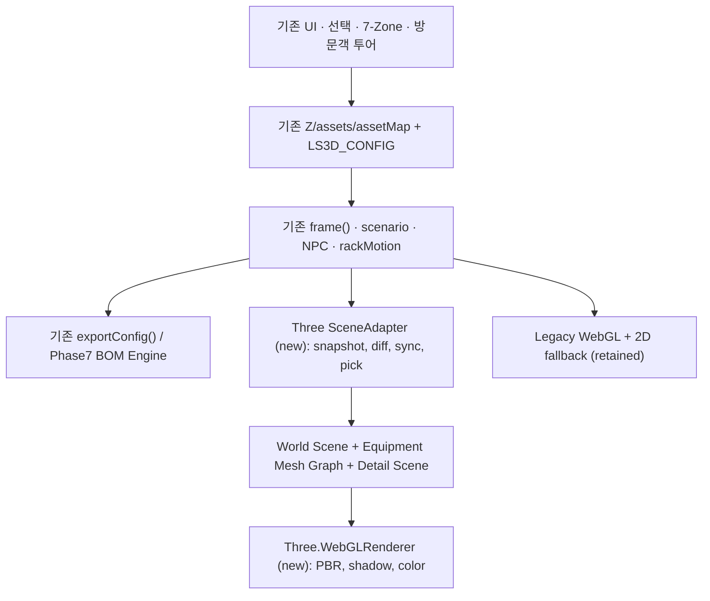

# STEP 02 — Three.js 전환 구조 설계 및 검증 보고서 (ADR-002)

> 상태: **설계 완료 / 코드 전환 미실행** · 2026-10-15 KST  
> 프로젝트: LS Datacenter Campus 3D v4.7.0 → N-XI 스타일 3D Digital Twin  
> 대상: `DCI/DataCenter/LS_Datacenter_3D.html` · 브랜치 `main`  
> 작업 범위: 20개 업무 중 **02/20**. **03번 구현은 시작하지 않는다.**

## 1. 의사결정 요약

**결정: 자체 WebGL 렌더링 계층을 Three.js WebGLRenderer로 점진적으로 교체한다(호환 어댑터 + 기능 플래그 + 레거시 복귀 경로).**

- 현재 데이터, 상태, 전력/냉각/네트워크 계산, 7개 구역, BOM 연계, 투어 및 이벤트 시스템은 보존한다.
- `assets`, `Z`, `rackMotion`, `T=window.__LS3D_TEST__`, `window.LS3D_CONFIG`, `ls3d-tick`을 **원천 상태(source of truth)** 로 취급한다.
- 신규 Three.js는 월드/장비의 렌더링과 선택 처리를 담당하며, 시뮬레이션 수치나 운영 로직을 중복 구현하지 않는다.
- 초기에는 *기존 렌더러가 기본*, 새 엔진은 `?engine=three`에서만 활성화한다(해당 플래그는 **향후 구현 예정**).
- 엔진 부팅/리소스 오류 시 `?engine=legacy`에서 확실하게 복귀 가능하게 한다. 새 엔진을 기본값으로 바꾸는 작업은 회귀 검증 후 별도 승인 대상으로 한다.
- 다음 작업(03)은 **Three.js 씬/렌더러·카메라·조명·기본 장비 프리미티브 구현**까지이며, 고급 시설 형상/에셋/게임형 NPC·랙 내부 조작의 완전 구현은 04~17번에서 한다.

## 2. 실제 소스 조사 — 현 상태 증거

정적 검토 기준 blob SHA:
- 3D `LS_Datacenter_3D.html`: `2beb285d8512e1e062032846c5e3d1d801d8f959`
- 보호 대상 2D `LS_Datacenter_Campus.html`: `9c84f24f2101043d7c113ce2d0da50e7245bc318`
- 보호 대상 BOM `index.html`: `692767f0c234df3b8310642e3acd032137c68baa`

| 범위 | 실제 식별된 심볼 / 연결 | 설계 시 보존해야 할 점 |
|---|---|---|
| 메인 HTML 초반 | `Z`에 7개 구역; `assets`, `assetMap`, `addAsset()` | 구역 및 `id` 정체성, 위치·상세값 유지 |
| 상태·애니메이션 | `rackMotion`, `setMechanical()`, `stepMechanical()` | 열린 문/서버/카세트 값이 실제 메시 transform에 연결되게 할 것 |
| NPC | `npcs`, `npcRoutes`, `routeSample()`, `npcPose()` | 업무/대피 시나리오 및 임시 출동 경로를 표시 모델에 전파 |
| 자체 WebGL | `canvas.getContext('webgl')`, `shaderVert`, `shaderFrag`, `gl.drawArrays` | 기본 렌더러가 3D가 아닌 이미지 교체 방식은 아님. 단, 현재 소재/형상 품질 한계 |
| 지오메트리 | `box()`, `line()`, `cylinder()`, `ring()`, `drawScene()`, `render3D()` | 절대좌표 프리미티브를 계속 호출하는 플러그인이 있으므로 전환 접점 필요 |
| 최적화 | `LS3D_PHASE4_CACHE`, `LS3D_RENDER_METRICS`, frustum/LOD 관련 함수 | 새 Three metrics 추가하되 기존 진단 UI가 사라지지 않게 |
| 기존 카메라·조작 | `cameraFrame()`, `getProjection()`, `pickAt()`, `initControls()`, `collide()` | 하나의 활성 카메라 및 포인터 이벤트 계통; 포커스·투어·벽 충돌 |
| 주 애니메이션 | `frame(now)` → `stepMechanical`, `updateWalk`, `render3D` → `ls3d-tick` | requestAnimationFrame을 **추가하지 않음**; 기존 단일 루프 유지 |
| 테스트 계약 | `window.__LS3D_TEST__` (기존 export와 동적 접근자) | 통합 테스트/외부 확장 스크립트의 표면 API 유지 |
| 인입 스크립트 | `server-room-geometry.js`, `Extensions.js`, `Phase2A/B.js`, `Phase45.js`, `phase7-bom-engine.js`, `phase7-compatibility.js`, `Phase6/7/8.js` | 총 10개 스크립트의 순서 및 사용 API 보존 |
| BOM | `Extensions.js`: `T.exportConfig=buildPayload`; schema `lsdc-twin-bom/1.0` | packet/동작·링크·예시값 변경 금지 |
| Phase 8 | `window.LS3D_PHASE8.run()` 통합 검사 | 엔진 전환 이후에도 회귀 검증 유지 |

### 확인된 위험과 해결 방향

1. **기존 HTML의 렌더러가 최상단 즉시 초기화됨:** 같은 `#scene` canvas에서 기존 GL context와 새로운 WebGLRenderer를 동시에 쓰면 GL 상태·소유권이 충돌할 수 있다. **서로 다른 두 canvas**를 두고 활성 엔진만 표시/입력/드로우한다.
2. **확장 파일의 전역 결합:** `Phase2B`가 `window.LS3D_PHASE1_RENDER`를 감싼다. `Phase2A/Phase6` 등은 `window.LS3D_RESPONSE_VISUALS`에 `ctx.box/line/cylinder` 호출을 등록한다. 새로운 어댑터에서 이 레거시 도형 호출을 장기적으로 메시/라인으로 변환할 경로를 둔다. 이 레이어가 없다면 MEP/대피 연출이 누락될 수 있다.
3. **NPC 동작 공급자가 다층임:** 메인 `npcPose` 및 기존 화재 대피 오버라이드와 `Extensions.js`의 `T.npcPose` 출동 오버라이드가 혼재한다. 신규 렌더러는 런타임 `T.npcPose(n)`를 우선 사용하고 재난·출동별 결과가 같음을 검증한다.
4. **기존 설비는 동적으로 생성·수정됨:** `Extensions.js`의 `layout()`이 `T.assets`에 `gpu-dyn-` 장비를 추가하고 위치/크기/hidden을 바꾼다. 초기 1회 복사 대신 `id` 중심 차분 동기화가 필요하다.
5. **회사 서버실 모드는 건물 밖 자산 미표시가 필수:** `LS3D_ASSET_RENDER_FILTER`, `roomBounds()`, `assetInsideRoom()`, `serverRoomFlowPaths()` 규칙을 새 씬의 랙·장비·MEP·링크에 모두 적용해야 한다. 기본 scene 전체를 그대로 출력하면 회귀.
6. **축척이 현실 CAD 단위와 일치하지 않음:** 현재 예제 랙 높이 `h=6`은 교육용 장면 좌표이고 실제 42U/48U 규격으로 간주할 수 없다. STEP 03에서 전체 좌표를 일괄 m로 재규격화하면 동선·충돌·설비 ID가 무너질 수 있어 기존 world 좌표를 일단 유지한다. 현실 치수 부품은 STEP 10부터 별도 rack-local scale을 사용한다.
7. **극단적 줌과 카메라 clipping:** 기존 `phase1Near`는 매우 작은 값을 취할 수 있다. Three.js에서는 세계 좌표 그대로 microscopic near plane을 강행하지 않고 상세 모드 전용 local scene/검사 카메라를 추후 단계에 마련한다.

## 3. 대안 비교 및 설계 결정

| 대안 | 그래픽·CAD형 계층 | 기존 기능 리스크 | 운영 난이도 | 결론 |
|---|---|---|---|---|
| A. 자체 WebGL 유지+효과 증설 | 낮음~중간; 모델/애니메이션/GLTF 유지보수 직접 구현 | 낮음 | 장기적으로 높음 | 제외 |
| B. 기존 파일 전체 Three.js로 일괄 재작성 | 높음 | **매우 높음**; 복잡한 확장·BOM 회귀 우려 | 초기 높음 | 제외 |
| **C. Three.js 증분 마이그레이션 + 호환 계층** | **높음**; scene graph, 조명/PBR, GLTF·LOD 지원 | **통제 가능**; 단계별 기능 플래그/복귀 | 중간 | **선택** |

선택 기준: 공학적 디지털 트윈 품질, 단계별 작업 분할, `main` 안정성 및 원본 2D/BOM 불변 조건의 동시 달성.

## 4. 목표 아키텍처



**핵심 원칙:** UI/시뮬레이션은 기존 코드가 소유. 렌더러는 그 상태의 **read-only view**이다. 카메라 변경/장비 선택은 기존 `T.pickAsset`, `T.setZone` 호출로 상태 변경하도록 연결한다.

### 예상 파일 구조 — 모두 **미생성, STEP 03 이후 제안**

```text
DCI/DataCenter/
  LS_Datacenter_3D.html                   # STEP 03에서 최소 진입점/게이트 패치
  assets/datacenter-3d/                   # STEP 04 이후 GLB/텍스처
  ls3d-three/
    bootstrap.js                          # 동적 import, 로딩 실패 레거시 복귀
    scene-adapter.js                      # 기존 state → scene graph, diff sync
    renderer.js                           # renderer/scenes/lights/resize/quality
    camera-controller.js                  # orbit/walk/worker, select/focus, clipping
    asset-registry.js                     # assetId ↔ Object3D 등록/해제
    geometry-primitives.js                # 장비 식별 가능한 형상(초기 간략판)
    legacy-geometry-bridge.js             # 기존 추가형 ctx 도형 호출 호환
    picking.js                            # Raycaster/InstanceId → T.pickAsset
    profiles.js                           # server-room/onprem/aidc visibility
    diagnostics.js                        # draw calls, fps/frame time/memory 상태
    rack/                                 # STEP 10~14
    npcs/                                 # STEP 06~09
    mmr-colo/                             # STEP 15~16
    routing/                              # STEP 17
```

향후 실제 구현 시 디렉터리를 지나치게 잘게 나누어 ES 모듈 로딩을 과도하게 늘리지 않는다. 소스 분리는 책임 경계이며 배포 자산은 추후 정적 bundle 또는 동일 버전 CDN으로 구성한다.

## 5. 정규 상태/형상 계약 (API Contract v1, 설계)

```ts
type Zone = {
  id: 'campus'|'utility'|'cooling'|'gray'|'hall'|'network'|'ops';
  pos: [number, number];       // 현행 [worldX, worldZ]
  size: [number, number];      // 현행 [width, depth]
};
type Asset = {
  id: string; zone: Zone['id']; name: string; type: string;
  x: number; z: number; w: number; d: number; h: number;
  hidden?: boolean; down?: boolean; power?: string; desc?: string;
};
type RackState = {
  door: number; slide: number; cassette: number;
  targetDoor: number; targetSlide: number; targetCassette: number;
  cables: string; rear: boolean;
};
type SceneAdapter = {
  status(): 'loading'|'ready'|'failed'|'disposed';
  sync(snapshot: Snapshot): void;  // active profile, zone, assets, NPC, rack states
  render(dtSeconds: number): void;  // 기존 frame()에서만 호출
  pick(clientX: number, clientY: number): string | null; // assetId 또는 null
  dispose(): void;                 // GL resources / event listeners 정리
};
```

추가 규칙:
- `Z` 및 `assets`를 Deep Clone 후 독자 운영하지 않는다. `assetMap` 키는 `id`; `Object3D.userData.assetId`에 역매핑한다.
- 각 `Asset`의 `(x,z)`는 기존 **장면 좌표**. y=0을 바닥으로, 레거시 `box(x,y,z,w,h,d)`의 y는 **바닥면**으로 취급한다. Three `BoxGeometry` center.y = y+h/2.
- 서로 다른 `facilityMode`에서 3D 장비 구성은 `T.visibleAssets()`와 `T.visibleZones()`를 따른다. 단 `T.visibleZones` 실제 존재/명칭은 기존 `T.visibleZones` 테스트 API에 맞춰 확인 후 구현한다.
- 장비는 `Asset.id` 기준 업데이트/교체/제거한다. 레거시 플러그인의 `addAsset`, `hidden`, `layout` 적용 후 stale geometry가 남지 않아야 한다.
- 카메라 `[x,y,z]` 월드축 그대로 유지, Three의 Y-up. 1인칭/walk, NPC follow와 visitor third-person의 권한이 충돌하지 않도록 활성 모드 우선순위를 정한다.
- 장비 포트/케이블 정보는 후속 STEP에서 네트워크 원천 topology packet과 별도 시각/교육용 링크를 구분한다. 설비 수치를 3D 디테일만으로 변경하지 않는다.

### 외부 호환성 표면

| 기존 인터페이스 | Three 전환 연결 | 회귀 테스트 |
|---|---|---|
| `T.setZone(id,focus)` | 씬 가시성 및 카메라 focus 갱신 | 7개 구역 버튼 |
| `T.pickAsset(asset,focus)` | Raycaster 결과 ID→기존 Asset → 원래 선택 API | 클릭/검색/우측 패널 |
| `T.setMechanical(a,action)` | 논리 상태 유지, 문·서버·카세트는 mesh transform 반영 | 열기/닫기/인출 복귀 |
| `T.npcPose(n)` | 매 tick worker transform 반영 | 기본 순찰/화재/출동 |
| `T.visibleAssets()` + `LS3D_ASSET_RENDER_FILTER` | scene diff 및 server-room 절대 필터 | 서버실 외부 객체 0 |
| `window.LS3D_RESPONSE_VISUALS` / `LS3D_PHASE1_RENDER` | 레거시 ctx adapter; 새 정밀 객체가 생기면 명시적으로 대체 | MEP, 광, 비상 출동 연출 |
| `T.exportConfig()` | **렌더러 무관**으로 기존 로직 유지 | schema `lsdc-twin-bom/1.0`, Phase 7 |
| `window.LS3D_PHASE4_CACHE`, `LS3D_RENDER_METRICS`, Phase5/8 | 레거시 진단 보존, 새 backend 카운터 별도 추가 및 UI 매핑 | Phase5 진단 및 Phase8 회귀 |
| `window.__LS3D_VISITOR__` | 투어 전환/이동/자동모드 상태를 새 카메라와 일치 | 방문 절차, 수동/자동 |
| `ls3d-tick` | 기존 이벤트를 재사용; 추가 RAF 또는 중복 tick 금지 | 비디오 프레임/시뮬레이션 시간 일관성 |

## 6. 캔버스·렌더링 루프·입력 이벤트 설계

### Canvas 분리 및 엔진 게이트

- `#scene`: 기존 레거시 WebGL canvas를 유지한다. 기존 `const canvas=$('scene')` 및 화면 상호작용 코드와 호환.
- `#sceneThree`: STEP 03에서 동일 viewport 안에 sibling canvas 추가. 새 엔진 `WebGLRenderer({canvas: sceneThree, antialias: ...})` 전용.
- 한 시점에 한 캔버스만 표시하고 `pointer-events` 활성화한다. 전환 시 UI 선택/카메라 상태를 보존하고 입력 리스너 중복을 방지한다.
- 기존 `frame()`만 RAF를 예약한다. `render3D(dt)` 내부에 `engine==='three' && adapter.ready` 선택 분기를 두고, Three를 사용 중이면 레거시 `drawScene / gl.*` 렌더 호출은 건너뛴다. `stepMechanical()`, `updateWalk()`, `refresh()`, `ls3d-tick`는 매 프레임 기존 규칙 유지.
- 기존 Stage 5 진단이 `#scene.getContext('webgl')`을 직접 조회하므로 active canvas 조회 함수 또는 진단 adapter를 반영한다.
- GL context lost, 모듈 import 실패, renderer 생성 실패 시 **기존 canvas로 돌아가며 오류 이유와 원복 상태를 로그**에 남긴다. 오류 후 두 루프가 중첩되어서는 안 된다.
- **STEP 02 시점에는 위 canvas, feature-flag, 모듈, 분기 코드가 아직 존재하지 않는다.**

### 입력 및 검사

- 레거시 canvas 이벤트와 새 canvas 이벤트의 활성화가 동시에 발생하지 않도록 engine별 구독 범위를 제한한다.
- Three `Raycaster.intersectObjects` 대상으로 선택 가능한 장비 메시만 선택하고 `mesh.userData.assetId`를 통해 원본 `T.pickAsset` 호출한다. InstancedMesh의 `instanceId`는 인스턴스별 asset ID 매핑을 사용한다.
- orbit/walk/follow/visitor mode는 기존 `cameraDesired`, `walkPos`, `workerViewId` 등의 상태를 동기화하며, 렌더러 자체는 모드 상태를 중복 소유하지 않는다.
- 선택 랙/설비가 벽에 가리면 가림 메시 레이어 숨김 또는 raycast 기반 카메라 안전 지점을 계산한다. 관찰 편의를 위한 clipping은 시공 기준 거리 계산과 구분한다.

## 7. 라이브러리·배포·자산 계약

- **Three.js 정확히 `0.186.1`(r186.1) 고정**, `WebGLRenderer` 우선. 확인 기준: npm `three` 버전 이력, three.js 공식 설치 문서. 다른 버전의 addons 혼합 금지.
- 외부 CDN 임시 방식의 **제안 import map** (아직 사이트에 적용하지 않음):

```html
<script type="importmap">
{
  "imports": {
    "three": "https://cdn.jsdelivr.net/npm/three@0.186.1/build/three.module.js",
    "three/addons/": "https://cdn.jsdelivr.net/npm/three@0.186.1/examples/jsm/"
  }
}
</script>
```

- `GLTFLoader`, `OrbitControls`를 `three/addons/...`에서 동일 버전으로 가져온다. `OrbitControls`가 기존 제스처/키보드 조작과 중복하지 않도록 기존 state 중심 controller만 사용하거나 제한된 모드에만 적용한다.
- GitHub Pages는 프로젝트 하위 경로 `/LSCNS/DCI/DataCenter/`에서 제공하므로 모델/텍스처/ESM 경로는 **문서 상대 URL(`new URL('../assets/...', import.meta.url)`)** 또는 import-map 상대경로를 사용한다. 사이트 루트 `/assets/...` 금지.
- 네트워크 CDN 장애 때 기본 레거시가 즉시 동작해야 한다. 가능하면 후속 단계에서 라이선스 고지와 함께 같은 정확한 Three 버전을 repository vendor로 자체 호스팅하여 외부 의존도를 제거한다.
- 정적인 `assets/campus-tour/` 이미지를 고품질 3D 모델의 대체물로 재활용하지 않는다. GLB/GLTF는 엔지니어링 검증된 부품 계층과 애니메이션 채널을 구분한다.
- 제작 또는 사용 승인 받은 GLB만 사용하고 출처/라이선스/제조사 검증 여부를 별도 manifest에 기록한다.
- 색/조명은 sRGB 출력, 중립 톤 매핑, PBR 소재, Hemisphere/Ambient + 방향성/영역별 조명. 그림자 적용은 품질 설정에 따라 탄력 운영.
- 모바일 및 구형 장치 fallback을 고려하여 WebGL 우선. WebGPU 강제 불가.

참고 문서:
- https://threejs.org/manual/pages/installation.html
- https://threejs.org/manual/pages/fundamentals.html
- https://www.npmjs.com/package/three?activeTab=versions
- https://threejs.org/docs/#examples/en/loaders/GLTFLoader

## 8. 03→후속 작업의 구체적 이행 및 롤백

| 시점 | 코드 변경 범위 | 필수 합격 조건 | 실패 시 |
|---|---|---|---|
| STEP 03-A | 신규 `ls3d-three/*` + `#sceneThree`; feature-flag 기본 legacy | 모듈 import/지오메트리/resize/render/frame 동작 | `engine=legacy` 또는 default 경로 |
| STEP 03-B | 기존 world 상태 → Three 씬 최소 표시 | 7 zones·자산 선택·상태 동기화·최소 시각화 | 새 engine 비활성화, 원본 기능 유지 |
| STEP 03-C | 기존 카메라/제스처/진단 연결 및 조명 | 레거시 동등 핵심 UI, 모바일 주요 동작, 로그 에러 0 | Three 기능 플래그 끔 |
| STEP 04~05 | 캠퍼스/플랜트 고품질 모델, GPU instancing, LOD | 실루엣·표면·깊이 구분, 성능 측정 | 장비별 단순 프리미티브 fallback |
| STEP 06~09 | NPC/보안 애니메이션 및 NavMesh/A* | 충돌 회피·보안 시연 | 기존 순찰/보안 시연 유지 |
| STEP 10~17 | 랙·MMR/Co-lo·물리 연결경로 | 독립 3D 부품 transform, selection 및 cross-connect | 장비/배선 단위 fallback |
| STEP 18~20 | UX·브라우저 검증·main 최종 전환 | 실제 Playwright 및 수동 기기 점검, 보호 SHA 보존 | legacy 기본으로 되돌림 |

**배포 정책:** 3번 구현이 완료되더라도 별도 승인 없이 새 엔진을 기본으로 강제 전환하지 않는다. 중간 main 커밋의 `engine=legacy` 기본 동작은 동일해야 한다. 롤백은 삼중 보호: (1) 쿼리 강제, (2) 부팅 오류 자동 회귀, (3) Git revert/재배포.

## 9. 정밀 모델/애니메이션/성능 구현 규칙

1. 모든 고정 설비는 Object3D 계층에 `assetId`를 가진다. 모니터/HMI·환기구·배관·케이블 트레이 등을 단순 block label이 아닌 실제 메시로 만든다.
2. 도어는 `THREE.Group` pivot(경첩 위치) `rotation.y`; 서버는 인출 방향 local axis translation; 광 카세트도 local z rail translation. 전면/후면 측정은 독립 camera pose.
3. `rackMotion`의 현행 0~1 보간값이 메시 변환의 원천이며 로직과 애니메이션 시간을 재구현하지 않는다. 각 조작 전후 bounds와 culling 업데이트.
4. 케이블은 길이/색상/속도 정보가 분리된 `Curve3` 기반 `TubeGeometry` 또는 저비용 점/메시 선형 표현으로 연출하되 실제 통신 규격으로 인증하지 않는다.
5. 다수 반복 랙/타일/조명은 `InstancedMesh`와 shared geometry/material 사용. 장비 조작 대상은 독립 객체로 승격할 수 있게 설계한다.
6. `frustumCulled`, LOD는 기존 레거시 개념과 동일한 화면 목적이나 Three API로 새 구현. GPU 자원 `dispose()`를 life-cycle에 포함.
7. 측정 지표: active renderer, 모델/triangle count, draw calls, FPS median/p95 frame time, 렌더 시간, RAM/VRAM 추정 및 WebGL 오류. 기준 시점 실측값이 아직 없으므로 개선율/확정 FPS를 **주장하지 않는다**.
8. 테스트는 desktop 1920×1080, 중간 노트북 1366×768, mobile 390×844를 최소 타깃으로 하고 실제 기기 성능은 별도 측정. FPS 목표는 대상 장치 기준 마련 후 확정한다.

## 10. STEP 03 필수 Acceptance / 회귀 테스트 계약

| ID | 확인 사항 | 기대 결과 |
|---|---|---|
| A01 | `?engine=legacy` | 기존 WebGL 화면과 모든 기존 UI 기능 유지 |
| A02 | `?engine=three` | 실제 Three.Scene/mesh 및 WebGLRenderer 구동; default 이미지 스왑 아님 |
| A03 | 라이브러리 | `three@0.186.1`과 addons 동일 버전; 404/CORS/import 오류 0 |
| A04 | 주 루프 | RAF 1계통, `ls3d-tick` 1계통, 시나리오 시간 중복 가속 없음 |
| A05 | 7구역 | campus/utility/cooling/gray/hall/network/ops 선택·가시성 정상 |
| A06 | 프로필 | aidc/server-room/onprem 각각 표시·카메라 정상 |
| A07 | server-room 격리 | 회사 서버실 건물 밖 설비/MEP/광 링크/사람 표시 0 |
| A08 | 선택·검색 | world raycast 자산 ID가 기존 `T.pickAsset`/패널과 일치 |
| A09 | 랙 조작 | 기존 door/slide/cassette/rear 논리 상태/컨트롤 정상; 새 메시 미구현 기능은 '미구현'으로 표시 |
| A10 | NPC·시나리오 | 기존 순찰·정지·화재 대피·출동 함수 결과와 시각 일치 |
| A11 | BOM | `T.exportConfig().schemaVersion==='lsdc-twin-bom/1.0'`; Phase 7 계산/경고 동일 |
| A12 | Phase 8 | `window.LS3D_PHASE8.run()` 전체 항목 검증, 이전 실패 항목과 신규 실패 구분 |
| A13 | 방문객 투어 | `__LS3D_VISITOR__` 수동/자동, 영역 전환, 1/3인칭 |
| A14 | 기기 테스트 | viewport/resize/회전/드래그/핀치, 레이아웃 충돌·누락 없음 |
| A15 | 오류 복구 | Three import 또는 WebGL 실패 시 legacy로 원복, 유저 기능 계속 이용 |
| A16 | 성능 | 기존 Phase 5와 동일 장치·시나리오에서 비교 기록; 수치 없이 '최적화 완료' 주장 금지 |
| A17 | 변경 파일 보호 | 보호 대상 2D·BOM SHA 불변, 변경 목록에 보호 파일 없어야 함 |

**Playwright 자동화 설계(후속 단계):** 동일 시나리오에 `engine=legacy`와 `engine=three`를 각각 실행, 콘솔/네트워크 오류를 수집하고 대표 장면을 desktop/mobile 캡처. 모든 기능을 자동으로 입증할 수 없는 NPC 경로 충돌/실제 기기 성능은 별도 수동 검증/시뮬레이션 계측을 분리한다.

## 11. STEP 02 실제 수행한 검증 (2026-10-15)

| 검증 ID | 검사 방법 | 관찰된 결과 | 판정 |
|---|---|---|---|
| D01 | GitHub `main` 파일 조회 | 3D blob `2beb285d...`, 메인 버전 v4.7.0 | PASS |
| D02 | 3D `Z` 소스 검색 | `campus, utility, cooling, gray, hall, network, ops` 7종 확인 | PASS |
| D03 | `getContext('webgl')`, 셰이더, `drawScene()` 검사 | 기존 자체 WebGL 사용 확인 | PASS |
| D04 | `frame`, `render3D`, `__LS3D_TEST__` 코드 검사 | 단일 기존 주 루프와 export 진입점 확인 | PASS |
| D05 | `setMechanical`/NPC 함수 코드 검사 | 랙 상태/기존 동작 API 존재 확인 | PASS |
| D06 | `Extensions.js` 107~113행 검사 | `T.exportConfig=buildPayload`, schema `lsdc-twin-bom/1.0` 확인 | PASS |
| D07 | GitHub 연결된 파일 조회 | 메인 HTML이 읽는 별도 10개 `.js` 모두 열람 가능 | PASS |
| D08 | 기존 BOM·2D의 blob SHA 기준 비교 | 2D `9c84f24f...`; BOM `692767f0...` 원본과 동일 | PASS |
| D09 | Three.js 공식 설치 문서 및 npm 버전 이력 | ESM/importmap, 같은 버전 addon 관리, `0.186.1` 존재 확인 | PASS |
| D10 | 실제 Three 렌더/조작/Playwright | **아직 코드를 구현하지 않았으므로 수행하지 않음** | NOT RUN (STEP 03/19 예정) |

검증의 의미는 **설계와 정적 코드 계약 적합성**이다. GitHub 파일의 존재·함수 시그니처 검사는 브라우저 기능 정상 작동을 보장하지 않는다. D01~D09가 PASS라고 해서 고품질 그래픽, NPC 충돌 회피, 메쉬 조작이 개발되었다는 뜻이 아니다.

## 12. STEP 02 미수행 영역 및 다음 작업 인계

- **이번 커밋은 설계 문서만 추가/수정한다**. 신규 Three.js 실행 모듈, GLB, CSS, HTML, Playwright 스크린샷을 만들지 않는다.
- 실제 Chrome/Android/WebGL context 검증, 시각 품질 판단, 에셋 물리 치수 검증, NPC 경로 모델링, 개별 랙 조작은 완료하지 않았다.
- STEP 03에서는 가장 먼저 `?engine=legacy` 보존과 별도 canvas + 모듈 import, 단일 RAF 분기를 시험하고 나서 장면/렌더링 범위를 늘린다.
- 설계 변경이 필요한 코드 제약(특히 외부 callback `ctx.*` 및 server-room 격리)은 문서를 업데이트하되 기존 로직 변경 범위/테스트 결과를 반드시 남긴다.

**최종 판정: STEP 02 설계 완료. STEP 03 구현 미착수.**
